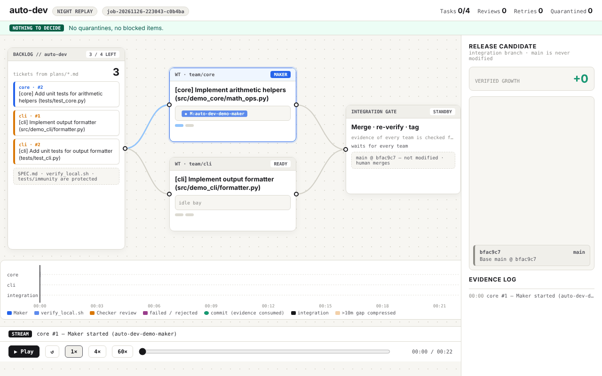

# Auto Developer

[日本語](README.md)

Auto Developer lets an AI agent work through your tasks one at a time while you are away (overnight, for example) **without drifting from the agreed specification and verification rules**. Both successful and failed work are left behind in a form a human can check afterwards.



*The dashboard replaying `auto-dev demo --teams`: tickets leave the backlog for the teams, and commits that passed verification and review pile up on the right.*

- **One task at a time; only verified and reviewed work is committed**: after the agent (the Maker) implements a task, the change must pass your verification script (linter, type checker, tests). A model from a different family (the Checker) then reviews it, reading only the SPEC and the diff. Only changes that pass both are committed.
- **Failures are quarantined, not thrown away**: work that fails verification or review is moved to a `quarantine/*` branch, and the main line is restored to the last good state.
- **Verifiable records**: verification results and the Checker's inputs and output are recorded, bound to hashes of the working tree and the SPEC. `auto-dev bundle` packs them into one ZIP, and `auto-dev verify-bundle` lets a third party check it for tampering and approval.
- **Protected files are enforced by machine**: if the agent changes `SPEC.md`, the verification script, `tests/immunity/` (regression tests for past failures), `.github/`, `teams.json`, or an approved design (`docs/designs/*.ir.json`), the run stops automatically.
- **From design document to draft plan (Spec Compiler)**: turns an EGM design document into drafts of the SPEC, the PLAN and a contract, with candidate impacts on existing tests. A draft becomes the contract only when a human reads and approves it.
- **Replay the night**: `auto-dev dashboard` builds a single HTML file from the records alone, showing on a timeline what happened and what a human needs to decide.
- **Multiple teams in parallel (experimental)**: each team has its own scope (`owns`) and gets its own Git worktree. Teams work in parallel; their work is re-verified and merged into an integration branch with an RC tag (merging into main is left to a human).

## Requirements

- Python 3.10 or later, Git 2.28 or later
- macOS (`sandbox-exec`) or Linux (`bwrap` / bubblewrap)
  - Untrusted tests, such as reproduction tests written by an auditor, run only inside the OS sandbox. If the sandbox is not available, that feature stops instead of running (`SANDBOX_UNAVAILABLE`).
  - On Linux, install `bubblewrap` (for example `sudo apt-get install -y bubblewrap`). On Ubuntu 23.10 and later, AppArmor may need configuring; the error message shows how.
- No runtime dependencies (standard library only).

## Try it in five minutes

Install it and run the demo. The demo runs entirely inside a temporary directory and does not use any external agent or model.

<!-- readme-test: run -->
```bash
pip install "git+https://github.com/hamatz/auto_developer.git"
auto-dev demo
```

The demo shows the following in one command:

1. Two good tasks pass verification and review and are committed.
2. A task that edits `SPEC.md` (a protected file) is detected and quarantined.
3. `auto-dev brief` shows the results and what to do next.
4. A bundle is created and `verify-bundle` reports `VERIFIED`.

Run `auto-dev demo --keep` to keep the demo directory and look inside.

You can also replay a night with two teams on the dashboard.

<!-- readme-test: run -->
```bash
auto-dev demo --teams
```

Two teams work in parallel (one fails verification once and fixes it on the second attempt), and their work is integrated with an RC tag. Open the `dashboard.html` shown at the end in a browser to replay the night (add `--keep` to keep the demo directory).

## Using it in your project

### 1. Initialize

Run `auto-dev init` in a Git repository to create the template files. Existing files are never overwritten.

<!-- readme-test: run -->
```bash
mkdir ~/my-project && cd ~/my-project
git init -b main
auto-dev init
git add -A && git commit -m "Add Auto Developer"
auto-dev pre-flight
auto-dev status
auto-dev dashboard
```

Files created:

| File | Purpose | Written by |
| --- | --- | --- |
| `SPEC.md` | Specification and invariants. The Checker reviews against this and the diff only | Human (the agent cannot change it) |
| `PLAN.md` | Task list (`- [ ] 1. ...` under `## ステップ`) | Human |
| `scripts/verify_local.sh` | Verification script. Passes only with exit code 0 | Human (the agent cannot change it) |
| `tests/immunity/` | Regression tests for past failures | Human (the agent cannot change it) |
| `.gitignore` | Lines that ignore generated files such as `.dev/` and `logs/`, and `.env`, are appended | Automatic |

The template `scripts/verify_local.sh` starts with setting lines (read from the first 20 lines).

- `# auto-dev: verify-timeout=300`: verification time limit in seconds.
- `# auto-dev: red-first=warn`: how the Red-First check is handled (`off` / `warn` / `enforce`). For tasks whose title contains `Red-First` or `Red:`, it checks in a temporary clone that the tests changed in that step fail against the checkpoint code and pass against the current code. `warn` only warns; `enforce` fails verification when this cannot be confirmed.

The template's "[2/3] project-specific rules" section contains commented-out examples (a forbidden pattern, an import that crosses layers). Whenever you feel like fixing the agent's work by hand, add that rule here as a check. The verification script is a protected file, so the agent cannot change it.

Replace the second half of `scripts/verify_local.sh` with your project's test command. Verification fails if there are no tests at all, so that it can never pass trivially. `auto-dev pre-flight` shows whether the working tree is clean and what the next task is. `auto-dev status` shows the current state and what needs a human decision, and `auto-dev dashboard` turns it into a single HTML file (`.dev/dashboard.html`).

### 2. Let an agent run it

You need agents to act as the Maker and the Checker. Use **models from different families** for them (for example Gemini and Claude). If they are from the same family, the commit is refused.

**Option A: through agent skills (Antigravity)**

This repository is an Antigravity plugin. Once installed, the following skills are available in chat.

<!-- readme-test: skip（Antigravity が必要） -->
```bash
agy plugin install https://github.com/hamatz/auto_developer
```

| Skill | What it does |
| --- | --- |
| `/nightly-setup` | Initialize (same as `auto-dev init`) |
| `/nightly-compile` | Draft the SPEC, PLAN and a contract from a design document (see below) |
| `/nightly-run` | Run the tasks in `PLAN.md` in order (per team if `teams.json` exists). Can also turn on the dashboard |
| `/nightly-bundle` | Create a bundle |
| `/nightly-verify <zip>` | Verify a bundle |

With this option the agent itself acts as the Maker and calls the low-level commands in order: `verify-step` → `review-input` → Checker review → `record-review` → `commit-step`.

**Option B: call external agent commands from the CLI**

<!-- readme-test: skip（外部のエージェントが必要） -->
```bash
auto-dev run \
  --maker-cmd "your-maker-cli --task {task_id} --context {context_file}" \
  --maker-model gemini-3.8-flash \
  --checker-cmd "your-checker-cli" \
  --checker-model claude-opus-5-5
```

- `--maker-cmd` may use `{task_id}`, `{task_title}`, `{context_file}` (task information as JSON), `{lessons_file}` (relevant lessons), `{attempt}`, and `{prev_error}`.
- The Checker command receives the diff and the SPEC on standard input and must print **exactly one** decision line (`DECISION: APPROVE` or `DECISION: REJECT`). Output from which no decision can be read is treated as not approved.
- If the family cannot be inferred from the model name, declare it with `--maker-family` / `--checker-family`.

### 3. Check the results

<!-- readme-test: skip（実行の結果が必要） -->
```bash
auto-dev brief                       # results and what to do next
auto-dev bundle                      # ZIP for handing over (sensitive files are excluded)
auto-dev verify-bundle <bundle.zip>  # check the ZIP for tampering and approval
```

Failed tasks are kept on `quarantine/<task>-<time>` branches; `brief` shows how to inspect and discard them. How to restore newly created files is shown at quarantine time and in the failure log (`logs/nightly/`).

### 4. Replay the night on the dashboard

<!-- readme-test: skip（実行の結果があると中身が出る） -->
```bash
auto-dev dashboard                   # write .dev/dashboard.html (replayable from the records)
auto-dev dashboard --enable          # from now on, rewrite it whenever a record is written (it updates while open)
auto-dev dashboard --disable
```

The dashboard is built only from Auto Developer's own records (events, evidence, review records, Git). Files that the agent writes about its own progress are not used.

## Starting from a design document (Spec Compiler)

Writing a good SPEC and PLAN takes practice. If you have an EGM design document (`docs/designs/*.md`, with sections such as Goals, CUJs, Architectural Decisions and Verification Plan), the agent skill `/nightly-compile` takes you to the drafts.

1. The agent reads the design document and writes an intermediate representation (IR) to `.dev/compile/<name>.ir.json`.
2. `auto-dev compile --check` checks it for missing acceptance criteria, contradictions with decisions, open questions and more; the agent fixes it until it passes.
3. A model from a different family reviews the IR against the design document.
4. `auto-dev compile --emit` writes a SPEC section, PLAN steps, `teams.json`, a contract, acceptance test outlines and candidate impacts to `.dev/compile/<name>/`.
5. **A human reads the contract, copies the drafts into SPEC.md and PLAN.md, and commits them.** The Spec Compiler never changes SPEC.md, PLAN.md or `teams.json`.

<!-- readme-test: skip（設計書と IR が必要） -->
```bash
auto-dev compile --outline docs/designs/my-feature.md   # headings mapped to IR parts
auto-dev compile --check .dev/compile/my-feature.ir.json
auto-dev compile --impact .dev/compile/my-feature.ir.json
auto-dev compile --emit .dev/compile/my-feature.ir.json
```

If you commit the approved IR as `docs/designs/<name>.ir.json`, the dashboard shows progress per requirement and warns when the design document changes later (`DESIGN_DRIFT`).

## Running multiple teams in parallel (experimental)

For now, all teams use the same Maker, Checker and verification, so splitting into teams gives you separated scopes and parallel execution, nothing more. Team-specific skills, models and review criteria are being considered for the next version. We recommend starting with a single team.

Describe each team's scope (`owns`) and plan file (`plans/<team>.md`) in `teams.json`. `auto-dev teams init` creates a template (two teams, `core` and `ui`, by default).

<!-- readme-test: run -->
```bash
mkdir ~/teams-trial && cd ~/teams-trial
git init -b main
auto-dev init
auto-dev teams init
git add -A && git commit -m "Add teams"
auto-dev teams prepare
auto-dev teams status
```

`teams prepare` creates a worktree (`.dev/worktrees/<team>`) and a branch (`team/<team>`) for each team. Then continue in one of two ways:

<!-- readme-test: skip（外部のエージェントが必要） -->
```bash
# All at once: prepare, run every team in parallel, and integrate
auto-dev teams run --maker-cmd "..." --maker-model ... --checker-cmd "..." --checker-model ...

# Step by step: after each team has finished (for example through agent skills), integrate
auto-dev teams integrate --job-id <job ID>
auto-dev teams cleanup --job-id <job ID>
```

Integration checks each team's verification and review records, merges the teams one by one, verifies again, and on success creates the `integration/<job ID>` branch and the `rc/<job ID>` tag. It does not change main. Work from a team that changed files outside its scope is quarantined instead of being integrated.

### Example (a calculator with two teams)

If you cloned this repository, `examples/two-teams/` contains a small two-team project. Run the following from the repository root to copy it under your home directory and try it.

<!-- readme-test: run -->
```bash
cp -r examples/two-teams ~/two-teams-trial
cd ~/two-teams-trial
git init -b main
git add -A && git commit -m "Start from the two-teams example"
auto-dev teams prepare
auto-dev teams status
```

## Command reference

All commands and options are listed in [docs/cli.md](docs/cli.md) (generated from the CLI definition). You can also use `auto-dev <command> --help`.

## Guarantees (selected invariants)

See section 3 of [SPEC.md](SPEC.md) (in Japanese) for the full list.

- Changes that have not passed verification and review are never committed.
- A change to a protected file stops the run immediately and is quarantined.
- Failed work is quarantined, not thrown away.
- Sensitive files (`.env*`, key files, and so on) are excluded from quarantine branches, bundles, and the diff given to the Checker.
- If the Maker and the Checker (or the auditor) are from the same model family, the review does not count as an approval.
- The review decision is read from the Checker's actual output, not from what the agent reports.
- If verification or review fails twice in a row for the same task, the run stops instead of guessing its way forward.
- Status displays are built from Auto Developer's own records.
- The Spec Compiler never writes the contract (SPEC, PLAN, `teams.json`).

## Appendix

This repository is itself developed with Auto Developer. See [PLAN.md](PLAN.md) for the plan, [LESSONS.md](LESSONS.md) for lessons learned, [AGENTS.md](AGENTS.md) for the rules agents follow, and [CHANGELOG.md](CHANGELOG.md) for the change history (these are mostly in Japanese).

## License

See [LICENSE](LICENSE).
