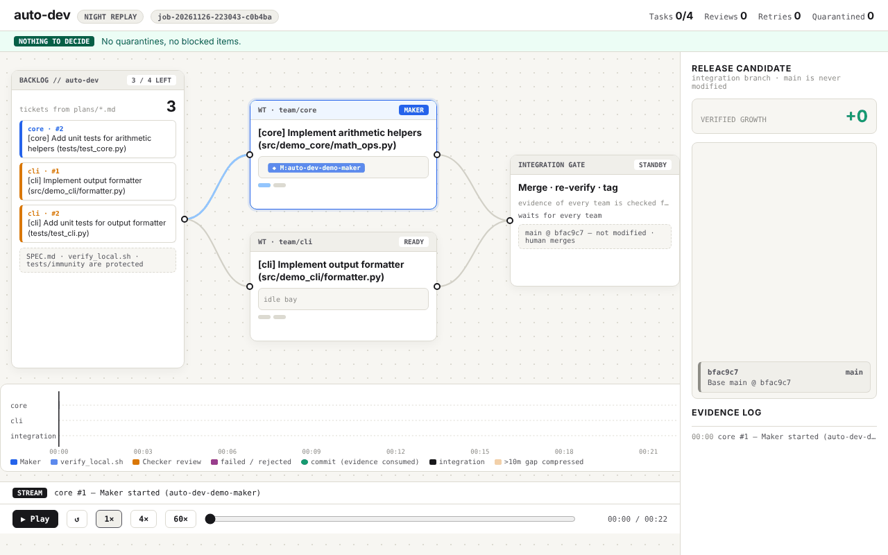

# Auto Developer

[English](README.en.md)

Auto Developer は、AI エージェントに開発を任せている間（夜間など、人間がいない間）も、**合意した仕様と検証の条件から外れずに**、タスクを1つずつ進めるための道具です。成功した作業も失敗した作業も、あとから人間が確かめられる形で残します。



*`auto-dev demo --teams` の夜を再生したダッシュボード。backlog のチケットがチームに渡り、検証と査読を通ったコミットが右に積み上がる。*

- **1タスクずつ、検証と査読を通ったものだけを確定する**: エージェント（Maker）が実装したら、検証スクリプト（リンター・型検査・テスト）を通し、さらに別系統のモデル（Checker）が SPEC と差分だけを読んで査読します。両方を通ったものだけがコミットされます。
- **失敗は捨てずに隔離する**: 検証や査読に通らなかった作業は `quarantine/*` ブランチに退避し、本線は直前の正常な状態に戻します。
- **あとから検証できる記録を残す**: 検証の結果と査読の入力・出力を、作業ツリーと SPEC のハッシュに結びつけて記録します。`auto-dev bundle` で1つの ZIP にまとめ、`auto-dev verify-bundle` で第三者が改ざんの有無と承認を確かめられます。
- **守るべきファイルは機械で守る**: `SPEC.md`、検証スクリプト、`tests/immunity/`（再発防止のテスト）、`.github/`、`teams.json`、承認した設計（`docs/designs/*.ir.json`）は、エージェントが変更すると自動で止まります。
- **設計書から計画の下書きを作る（Spec Compiler）**: EGM の設計書から、SPEC・PLAN・契約書の下書きと、既存のテストへの影響の候補を作ります。下書きを契約にするのは、人間が読んで承認したときだけです。
- **夜の作業を再生できる**: `auto-dev dashboard` が、記録だけから1枚の HTML を作り、何が起きて、何を人間が判断すべきかを時系列で見せます。
- **複数のチームで並行して進められる（実験的）**: 担当範囲（`owns`）を分けたチームごとに Git の worktree を作り、並行して作業させ、最後に検証し直してから統合のブランチと RC タグを作ります（main への取り込みは人間が行います）。

## 動作環境

- Python 3.10 以上、Git 2.28 以上
- macOS（`sandbox-exec`）または Linux（`bwrap` / bubblewrap）
  - 監査役が出した再現テストなど、信頼できないテストは OS のサンドボックスの中でだけ動かします。サンドボックスが使えない環境では、その機能は動かずに止まります（`SANDBOX_UNAVAILABLE`）。
  - Linux では `bubblewrap` を入れてください（例: `sudo apt-get install -y bubblewrap`）。Ubuntu 23.10 以降では AppArmor の設定が必要な場合があります。エラーの表示に対処の方法が出ます。
- 実行時の依存ライブラリはありません（標準ライブラリだけで動きます）。

## 5分で試す

インストールして、デモを実行します。デモは一時ディレクトリの中で完結し、外部のエージェントやモデルは使いません。

<!-- readme-test: run -->
```bash
pip install "git+https://github.com/hamatz/auto_developer.git"
auto-dev demo
```

デモでは、次の流れを1コマンドで見られます。

1. 正常な2つのタスクが、検証と査読を通ってコミットされる。
2. `SPEC.md`（保護ファイル）を書き換えるタスクが検知され、隔離される。
3. `auto-dev brief` で、結果と次にとるべき行動が表示される。
4. Bundle を作り、`verify-bundle` で `VERIFIED` になる。

`auto-dev demo --keep` とすると、デモのディレクトリを残して中を見られます。

2チームが並行して動く夜を、ダッシュボードで再生することもできます。

<!-- readme-test: run -->
```bash
auto-dev demo --teams
```

2つのチームが並行してタスクを進め（一方は検証に一度失敗して、2回目で直ります）、統合して RC タグを作ります。最後に表示される `dashboard.html` をブラウザで開くと、夜の作業を再生できます（`--keep` を付けると、デモのディレクトリが残ります）。

## 自分のプロジェクトで使う

### 1. 初期化する

Git のリポジトリで `auto-dev init` を実行すると、必要なファイルの雛形ができます。既にあるファイルは上書きしません。

<!-- readme-test: run -->
```bash
mkdir ~/my-project && cd ~/my-project
git init -b main
auto-dev init
git add -A && git commit -m "Add Auto Developer"
auto-dev pre-flight
auto-dev status
auto-dev dashboard
```

できるファイル:

| ファイル | 役割 | 誰が書くか |
| --- | --- | --- |
| `SPEC.md` | 仕様と不変条件。Checker はこれと差分だけを読んで査読する | 人間（エージェントは変更できない） |
| `PLAN.md` | タスクの一覧（`## ステップ` の下の `- [ ] 1. ...`） | 人間 |
| `scripts/verify_local.sh` | 検証スクリプト。終了コード 0 のときだけ合格 | 人間（エージェントは変更できない） |
| `tests/immunity/` | 再発防止のテスト | 人間（エージェントは変更できない） |
| `.gitignore` | `.dev/`、`logs/` などの生成物と、`.env` を除外する行を追記 | 自動 |

`scripts/verify_local.sh` の雛形の先頭には、設定の行があります（先頭の 20 行から読み取ります）。

- `# auto-dev: verify-timeout=300`: 検証の制限時間（秒）。
- `# auto-dev: red-first=warn`: Red-First の確認の扱い（`off` / `warn` / `enforce`）。題名に `Red-First` か `Red:` を含むタスクで、そのステップで変えたテストが、チェックポイントのコードでは失敗し、今のコードでは通ることを、一時的なクローンの中で確かめます。`warn` は警告だけ、`enforce` は確かめられなければ検証の失敗にします。

雛形の「[2/3] プロジェクト固有の規則」の段には、注釈にした例（使ってはいけない書き方、層をまたぐ読み込み）があります。エージェントの作業を手で直したくなったら、その規則を、ここに検査として足してください。検証スクリプトは保護ファイルなので、エージェントは変えられません。

`scripts/verify_local.sh` の後半を、あなたのプロジェクトのテストのコマンドに置き換えてください。テストが1件もないと、検証は失敗します（検証を素通りさせないためです）。`auto-dev pre-flight` は、作業ツリーがきれいかどうかと、次のタスクを表示します。`auto-dev status` は今の状態と人間が判断すべきことを、`auto-dev dashboard` はそれを1枚の HTML（`.dev/dashboard.html`）にしたものを作ります。

### 2. エージェントに実行させる

実行には、Maker と Checker を務めるエージェントが必要です。Maker と Checker には、**異なる系統のモデル**（例: Gemini と Claude）を使います。同じ系統だと、コミットの段階で拒否されます。

**方法 A: エージェントのスキルから使う（Antigravity）**

このリポジトリは Antigravity のプラグインになっています。プラグインとして入れると、チャットで次のスキルが使えます。

<!-- readme-test: skip（Antigravity が必要） -->
```bash
agy plugin install https://github.com/hamatz/auto_developer
```


| スキル | すること |
| --- | --- |
| `/nightly-setup` | 初期化（`auto-dev init` と同じ） |
| `/nightly-compile` | 設計書から、SPEC・PLAN・契約書の下書きを作る（後述） |
| `/nightly-run` | `PLAN.md` のタスクを順に実行する（`teams.json` があればチームごとに実行する）。ダッシュボードを有効にするかも選べる |
| `/nightly-bundle` | Bundle を作る |
| `/nightly-verify <zip>` | Bundle を検証する |

この方法では、エージェント自身が Maker を務め、`verify-step` → `review-input` → Checker の査読 → `record-review` → `commit-step` の順に、低レベルのコマンドを呼びます。

**方法 B: CLI から外部のエージェントのコマンドを呼ぶ**

<!-- readme-test: skip（外部のエージェントが必要） -->
```bash
auto-dev run \
  --maker-cmd "your-maker-cli --task {task_id} --context {context_file}" \
  --maker-model gemini-3.8-flash \
  --checker-cmd "your-checker-cli" \
  --checker-model claude-opus-5-5
```

- `--maker-cmd` には `{task_id}`、`{task_title}`、`{context_file}`（タスクの情報の JSON）、`{lessons_file}`（関連する教訓）、`{attempt}`、`{prev_error}` を書けます。
- Checker のコマンドは、標準入力で差分と SPEC を受け取り、出力の中に判定の行（`DECISION: APPROVE` または `DECISION: REJECT`）を**ちょうど1つ**書きます。判定が読み取れない出力は、不承認として扱います。
- モデル名から系統が分からない場合は、`--maker-family` / `--checker-family` で明示します。

### 3. 結果を確かめる

<!-- readme-test: skip（実行の結果が必要） -->
```bash
auto-dev brief                       # 結果と、次にとるべき行動
auto-dev bundle                      # 提出用の ZIP（機密のファイルは入らない）
auto-dev verify-bundle <bundle.zip>  # ZIP の改ざんの有無と承認を確かめる
```

失敗したタスクは `quarantine/<タスク>-<時刻>` のブランチにあり、`brief` に差分の見方と捨て方が表示されます。新しく作ったファイルの取り出し方は、隔離のときの表示と失敗ログ（`logs/nightly/`）にあります。

### 4. ダッシュボードで夜を振り返る

<!-- readme-test: skip（実行の結果があると中身が出る） -->
```bash
auto-dev dashboard                   # .dev/dashboard.html を作る（記録から再生できる）
auto-dev dashboard --enable          # 以後、記録が書かれるたびに作り直す（開いたまま更新される）
auto-dev dashboard --disable
```

ダッシュボードは、Auto Developer 自身が書いた記録（イベント、Evidence、査読の記録、Git）だけから作ります。エージェントが自己申告で書いたファイルは使いません。

## 設計書から始める（Spec Compiler）

良い SPEC と PLAN を書くのは、慣れていないと難しい作業です。EGM の設計書（`docs/designs/*.md`。Goals・CUJ・Architectural Decisions・Verification Plan などの節を持つもの）があれば、エージェントのスキル `/nightly-compile` で、下書きまで作れます。

1. エージェントが設計書を読み、中間表現（IR）を `.dev/compile/<名前>.ir.json` に書く。
2. `auto-dev compile --check` で、受入条件の欠け・判断との食い違い・未決の点などを点検し、通るまで直す。
3. 別系統のモデルが、設計書と IR を突き合わせて査読する。
4. `auto-dev compile --emit` が、`.dev/compile/<名前>/` に SPEC の節・PLAN のステップ・`teams.json`・契約書・受入テストの案・影響の候補を書き出す。
5. **人間が契約書を読み、SPEC.md と PLAN.md に写してコミットする**。Spec Compiler は SPEC.md・PLAN.md・`teams.json` を書き換えません。

<!-- readme-test: skip（設計書と IR が必要） -->
```bash
auto-dev compile --outline docs/designs/my-feature.md   # 見出しと IR の要素の対応
auto-dev compile --check .dev/compile/my-feature.ir.json
auto-dev compile --impact .dev/compile/my-feature.ir.json
auto-dev compile --emit .dev/compile/my-feature.ir.json
```

承認した IR を `docs/designs/<名前>.ir.json` としてコミットすると、ダッシュボードに要件ごとの進み具合が出て、設計書が後で変わったときに知らせます（`DESIGN_DRIFT`）。

## 複数のチームで並行して進める（実験的）

今は、すべてのチームが同じ Maker・Checker・検証を使います。チームに分ける利点は、担当範囲の分離と並行の実行です。チームごとにスキルやモデル、査読の基準を変える機能は、次の版で検討しています。まずは単一のチームで使うことを勧めます。

`teams.json` に、チームごとの担当範囲（`owns`）と計画ファイル（`plans/<チーム>.md`）を書きます。`auto-dev teams init` で雛形ができます（既定は `core` と `ui` の2チーム）。

<!-- readme-test: run -->
```bash
mkdir ~/teams-trial && cd ~/teams-trial
git init -b main
auto-dev init
auto-dev teams init
git add -A && git commit -m "Add teams"
auto-dev teams prepare
auto-dev teams status
```

`teams prepare` が、チームごとの worktree（`.dev/worktrees/<チーム>`）とブランチ（`team/<チーム>`）を作ります。そのあと、次のどちらかで進めます。

<!-- readme-test: skip（外部のエージェントが必要） -->
```bash
# まとめて実行: 準備・各チームの並行実行・統合まで
auto-dev teams run --maker-cmd "..." --maker-model ... --checker-cmd "..." --checker-model ...

# 分けて実行: 各チームを（エージェントのスキルなどで）進めたあと、統合する
auto-dev teams integrate --job-id <ジョブ ID>
auto-dev teams cleanup --job-id <ジョブ ID>
```

統合は、各チームの検証と査読の記録を確かめ、順にマージして検証し直し、成功すれば `integration/<ジョブ ID>` のブランチと `rc/<ジョブ ID>` のタグを作ります。main は変更しません。担当範囲の外のファイルを変えたチームの作業は、確定させずに隔離します。

### サンプル（2チームの電卓）

このリポジトリを clone した場合は、`examples/two-teams/` に2チーム構成の小さなプロジェクトがあります。リポジトリの直下で次を実行すると、ホームの下に写して試せます。

<!-- readme-test: run -->
```bash
cp -r examples/two-teams ~/two-teams-trial
cd ~/two-teams-trial
git init -b main
git add -A && git commit -m "Start from the two-teams example"
auto-dev teams prepare
auto-dev teams status
```

## コマンドの一覧

すべてのコマンドと引数は [docs/cli.md](docs/cli.md) にあります（CLI の定義から生成しています）。`auto-dev <コマンド> --help` でも確かめられます。

## 守っていること（不変条件の抜粋）

詳しくは [SPEC.md](SPEC.md) の 3 章にあります。

- 検証と査読を通らない変更は、確定させない。
- 保護ファイルの変更を検知したら、即座に止めて隔離する。
- 失敗した作業は捨てずに隔離する。
- 機密に当たるファイル（`.env*`、鍵ファイルなど）は、隔離ブランチ・Bundle・Checker に渡す差分に含めない。
- Maker と Checker（と監査役）が同じ系統のモデルなら、承認として扱わない。
- 査読の判定は、エージェントの申告ではなく、Checker の出力そのものから読み取る。
- 同じタスクで検証か査読に2回続けて失敗したら、推測で先に進まずに止まる。
- 状態の表示は、Auto Developer 自身の記録から作る。
- Spec Compiler は契約（SPEC・PLAN・`teams.json`）を書かない。

## その他

このリポジトリ自身も Auto Developer で開発しています。計画は [PLAN.md](PLAN.md)、教訓は [LESSONS.md](LESSONS.md)、エージェントへの規則は [AGENTS.md](AGENTS.md)、変更の履歴は [CHANGELOG.md](CHANGELOG.md) にあります。

## ライセンス

[LICENSE](LICENSE) を参照してください。
