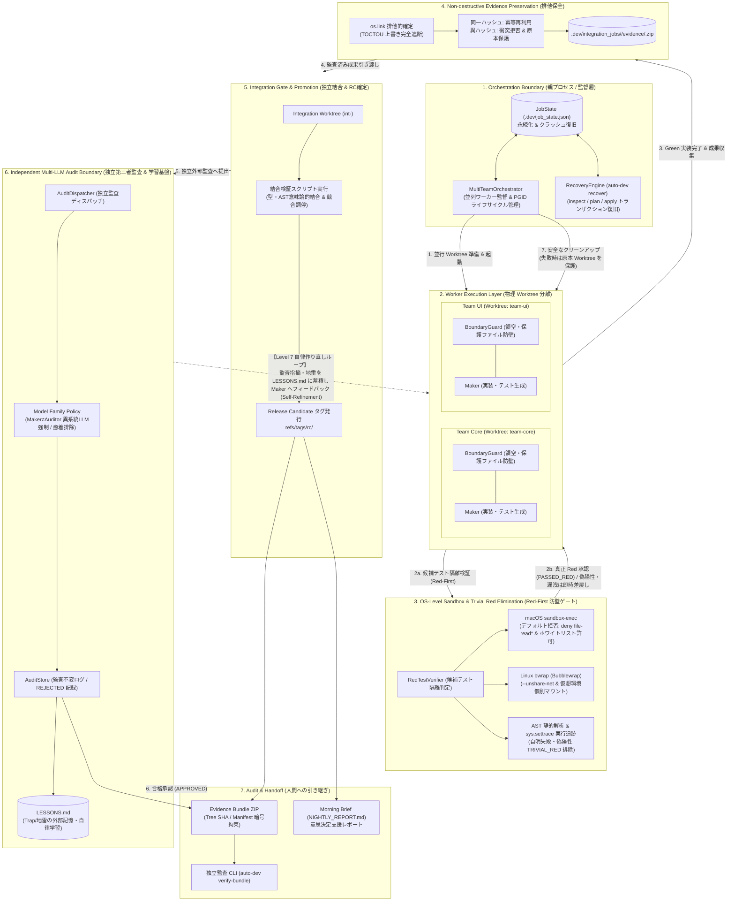

# Auto Developer: 自律型開発実行基盤 (Trustworthy Autonomous Runner)

[](.github/workflows/verify.yml)
[](plugin.json)
[](LICENSE)

> **Auto Developer は、人間が不在の間も、合意された仕様と客観的な検証条件に従って開発作業を進め、成功も失敗も検証可能な形で人間に引き渡す自律型開発実行基盤です。**
> Antigravity プラグイン（`/nightly-setup`, `/nightly-run`）または独立した CLI ツール（`auto-dev`）として、あらゆる既存・新規プロジェクトに導入できます。

Google Antigravity および [Agent Harness Kit 論文](https://github.com/hamatz/agent-harness-kit/blob/main/docs/paper.md) で提唱される Elephant-Goldfish Model（EGM）の設計規律に基づき、**「人間が一時的に仕事から離れること」** を開発プロセスの正常系として扱います。

---

## 🎯 なぜ必要なのか？（従来の課題と解決策）

自律型AIエージェントに複数タスクを一括して任せると、以下の問題で破綻します：
1. **会話セッション依存の脆弱性**: 長い対話セッションで全タスクを回すとトークンが逼迫し、セッション切断やクラッシュで作業がすべて蒸発する。
2. **テストコードの勝手な改ざん**: テストが通らないとき、エージェントがテスト側を弱めたり保護ファイルを書き換えて強引に通してしまう。
3. **未検証コードの混入**: 実装が完了していない、あるいは検証を通っていない変更がコミットされてしまう。
4. **全破壊ロールバックの代償**: 失敗時に `git reset --hard` すると、エージェントが数時間かけて書いた差分や中間ログまで消滅し、人間が引き継げない。

Auto Developer は、**「Job Orchestrator（親プロセスによる状態永続化）」「未追跡ファイルを含む物理防壁」「隔離退避（Quarantine Branch）」「証跡拘束確定ゲート（Evidence Gate）」「翌朝の意思決定支援（Morning Brief）」** により、人間不在でも安心して仕事を預けられる環境を提供します。

---

## 🏗️ システムアーキテクチャ

Auto Developer は、会話セッションから独立した Python オーケストレーター（`MultiTeamOrchestrator` / `NightlyOrchestrator`）が親となり、AIセッション（Maker / Checker）、複数チームの並行ワーカー、OS レベルサンドボックス、および独立した異系統 LLM 監査人を安全に監督・統合します。



### 多層防衛アーキテクチャの 6 大支柱と二重自律ループ (Dual-Loop Autonomous Architecture)

Auto Developer は、**「内側の安全な TDD 門番ループ」** と **「外側の自律的自己修復・作り直しループ（Level 7）」** の 2 つのフィードバックループが噛み合うことで、無人での長期自走と絶対的な安全性を両立します。

1. **親プロセスによるライフサイクル監督 & 障害復旧（Host Supervision & Transactional Recovery）**:
   - `MultiTeamOrchestrator` が PGID（プロセスグループID）単位でサブプロセスを統括し、親の不意の終了時にも孫プロセスを含む孤児プロセスを決定論的に回収。`.dev/job_state.json` による状態永続化と `auto-dev recover` によるトランザクショナルなクラッシュ復旧（inspect / plan / apply）を実現します。
2. **物理的分離と領空防衛（Worktree Isolation & BoundaryGuard）**:
   - 各チームは専用の独立 Git Worktree で物理隔離されて作業を行い、担当外ディレクトリ（領空）や保護対象ファイル（`.github/**`, `SPEC.md`, `scripts/verify_local.sh`, 免疫テスト）の改変はコミット前に物理遮断されます。
3. **OS レベルサンドボックス & 偽陽性 Red 排除門番（OS Sandboxing & Inner Red-First Loop）**:
   - **【内側ループ】** 単なる一過性の検査ではなく、テスト駆動開発（TDD）の安全な門番として機能します。候補テスト生成時、macOS `sandbox-exec`（デフォルト拒否 `deny file-read*`＋ホワイトリスト個別許可）および Linux `bwrap`（Bubblewrap によるネットワーク完全遮断 `--unshare-net`＆仮想環境個別マウント）でホストの機密情報（SSH鍵・クレデンシャル等）や元リポジトリへの干渉を物理遮断。
   - さらに AST 静的構文解析と動的 `sys.settrace` 実行トレースにより、自明な無条件失敗テスト（`self.assertEqual(1, 2)` 等）を `TRIVIAL_RED` として検知し即時 Maker へ差し戻します。真正な Red（`PASSED_RED`）のみが通過を許可され、本番コードの安全な Green 化へと進みます。
4. **非破壊的成果保全と独立統合ゲート（Atomic Preservation & IntegrationGate）**:
   - `os.link` による排他的・原子的 Evidence 保全を採用し、TOCTOU 競合による上書きを完全遮断。同一成果は冪等再利用し、異成果衝突時は Worktree 原本を安全に保護します。
   - 独立した統合 Worktree での意味論的結合検証を経て、原子的 Release Candidate タグ（`refs/tags/rc/<job_id>`）を発行します。
5. **暗号学的証跡と第三者検証（Evidence Bundle & Tamper-Proof Verifier）**:
   - Git Tree SHA、コミット SHA、Checker ログ、SPEC SHA がハッシュ拘束された不変の ZIP パッケージを生成。外部監査 CLI (`auto-dev verify-bundle`) により、改ざんや未検証成果の混入をオフラインかつ物理的に検出可能です。
6. **Multi-LLM 独立監査境界 & 自律作り直しループ（Level 7 Outer Self-Refining Loop）**:
   - **【外側ループ】** レベル 6 までの「失敗したら止まって人間に朝レポートする（Fail-Fast & Freeze）」を超え、**真の自律夜間開発（Level 7）の核心**を担います。
   - Maker と独立第三者 Auditor（例: Gemini Maker vs Claude Opus / GPT 6.1 Auditor）を分離して思考の癒着を排除。
   - 監査人が指摘した課題や拒絶（Findings）は、単に停止するのではなく即座に `LESSONS.md` へ地雷（Trap）として外部記憶化され、Maker へフィードバック。Maker はその教訓を元に自律的に「作り直し・再挑戦」のサイクルを回し、仕様（`SPEC.md`）と受入条件を完全に満たすまで粘り強く動き続けます。

---

## 📦 インストールと外部プロジェクトでの利用

Auto Developer は、本リポジトリ内だけでなく、**「Antigravity プラグイン」** または **「スタンドアロン CLI (`auto-dev`)」** のいずれの形態でも、あなたの既存プロジェクトや新しい作業フォルダに導入して利用できます。

---

### 方式 A: Antigravity プラグインとして利用する（推奨）

Auto Developer は Antigravity プラグイン規格（`plugin.json` および `skills/`）に完全準拠しているため、**GitHub リポジトリの URL を指定して直接オンラインからインストール**するか、**ローカルでシンボリックリンクを貼る**だけで利用できます。

#### 1. オンラインから直接インストールする場合（GitHub 公開時）
```bash
# Antigravity CLI からインストール
agy plugin install https://github.com/hamatz/auto_developer

# または Antigravity IDE / デスクトップアプリの UI から：
# 「Customizations」→「Plugins」→「+ Install from URL」に上記 GitHub URL を入力
```

#### 2. ローカル開発環境から登録する場合
```bash
# 1. プラグインディレクトリへシンボリックリンクを作成（初回のみ）
mkdir -p ~/.gemini/config/plugins
ln -s /path/to/auto_developer ~/.gemini/config/plugins/auto-developer

# 2. CLI も使えるように editable インストール
pip install -e /path/to/auto_developer
```

#### Antigravity チャットでの利用フロー：
1. **プロジェクト初期化**:
   新しいプロジェクトフォルダを Antigravity で開き、チャットで以下を実行します：
   ```text
   /nightly-setup
   ```
   EGM 規律ファイル群（`PLAN.md`, `SPEC.md`, `scripts/verify_local.sh`, `.gitignore`）が自動生成されます。
2. **夜間・無人自律実行**:
   `PLAN.md` にタスクを書いたら、離席時や就寝前にチャットで以下を実行します：
   ```text
   /nightly-run
   ```
   Antigravity エージェントがオーケストレーターと連携し、**[Maker実装 → 物理保護検査 → 確定検証 → 独立Checker査読 → 証跡ゲートコミット]** の厳格なサイクルを自動で直列実行します。
3. **成果提出パッケージの生成 (Evidence Bundle)**:
   開発成果や監査ログを第三者・クライアントに提出する際、チャットで以下を実行します：
   ```text
   /nightly-bundle
   ```
   機密情報（`.env` 等）を排除した完全な提出用 ZIP アーカイブが生成されます。
4. **提出成果物の独立監査・検証**:
   受け取った ZIP アーカイブの改ざんや承認状態を第三者として監査する場合：
   ```text
   /nightly-verify <path-to-bundle.zip>
   ```
   チェックサム整合性、Git Tree SHA 拘束、独立Checker の承認ログを自動監査してレポートします。

---

### 方式 B: スタンドアロン CLI (`auto-dev`) として利用する

ターミナルや外部エージェント CLI（Codex, Claude Code など）と組み合わせてコマンドラインから直接動かす場合：

```bash
# GitHub から直接インストールする場合（PyPI 公開不要）:
pip install git+https://github.com/hamatz/auto_developer.git

# またはローカルクローンから editable インストールする場合:
# git clone https://github.com/hamatz/auto_developer.git
# pip install -e auto_developer
```

#### ターミナルでの利用フロー：
```bash
# 1. 任意の作業フォルダで初期化
cd /path/to/your-project
auto-dev init

# 2. 自律パイプラインを実行
auto-dev run

# 外部エージェント CLI を Maker / Checker に指定する場合:
# auto-dev run --maker-cmd "..." --checker-cmd "..."

# 3. 翌朝、ブリーフィングを確認
auto-dev brief
```

---

## 🔰 5分で体験するクイックスタート (Hands-on Walkthrough)

まずは実際に手を動かして、Auto Developer の自律サイクルと防壁を体験してみましょう。

### 1. 前提条件と環境確認
```bash
# Python 3.10+ と Git があればすぐに動かせます
git status
bash scripts/verify_local.sh
```

### 2. ドライラン（シミュレーション実行）
Git 作業ツリーやファイルを一切変更せずに、`PLAN.md` のタスクがどう処理されるかを安全にシミュレーションします：
```bash
python3 scripts/nightly_orchestrator.py --dry-run
```

### 3. モック自律走行を体験する
簡単なサンプルタスクを使って、オーケストレーターが自動で実装・検証・査読・コミット・レポート生成を行う一連の流れを体験します：

```bash
# 一時的なブランチを作成してテスト
git checkout -b try-auto-developer

# テスト用の PLAN.md を作成
cat << 'EOF' > PLAN.md
# PLAN.md
## ステップ
- [ ] 1. サンプル計算関数の作成
EOF

# オーケストレーターを起動（Maker と Checker のコマンドを指定）
python3 scripts/nightly_orchestrator.py \
  --maker-cmd "python3 -c \"open('calc.py', 'w').write('def add(a, b): return a + b\n')\"" \
  --checker-cmd "echo 'APPROVE: Looks good'"
```

実行すると、ターミナルに以下が出力され、自動的にコミットされます：
```text
=== Starting Autonomous Orchestrator (Job: job-..., Total Tasks: 1) ===
▶ Processing Task [1]: サンプル計算関数の作成
  [Phase A: Maker] Running Maker for task 1...
  [Phase C: Verifier] Running scripts/verify_local.sh...
  [Phase D: Checker] Running independent review...
  [Phase E: Commit] Checker approved. Issuing evidence and committing...
Execution complete! Report written to NIGHTLY_REPORT.md
```

### 4. 翌朝のブリーフィングを確認する
朝起きたら、ワンコマンドで状況を確認できます：
```bash
python3 scripts/nightly_orchestrator.py morning-brief
```
ターミナルに「何が完了し、どこが安全にコミットされたか」が瞬時に表示されます。

### 5. 障害隔離（Quarantine）と中断復旧（Resume）を体験する
もしタスクが失敗した場合、**作業成果は捨てられず `quarantine/*` ブランチに保存** され、本線は直前のチェックポイントに戻ります：
```bash
# 失敗するタスクを意図的に実行
# （本リポジトリでは scripts/verify_local.sh 内の Ruff リンターが構文エラーを検知して即座に隔離されます）
python3 scripts/nightly_orchestrator.py \
  --maker-cmd "python3 -c \"open('broken.py', 'w').write('syntax error here')\""

# 状態を確認
python3 scripts/nightly_orchestrator.py morning-brief
```
出力された選択肢（`git diff ...` や `--resume`）に従って、人間が簡単に判断・引き継ぎできます。

> [!NOTE] 物差しの強さはテスト（検証ゲート）次第
> 「なぜ `broken.py` の構文エラーで隔離されたのか？」
> それは、本リポジトリの `scripts/verify_local.sh` にプロジェクト全体を走査するリンター（Ruff）が組み込まれているからです。
> もし単体テストのみを実行し、どのテストからもインポートされていないファイルであれば、構文エラーであってもテストランナーはエラーを検知せず通過してしまいます。
> **「検証ゲートが検査していない不具合は機械的に通過する」** という点こそが、AI自律開発における「物差しの強さは自分のテスト次第」という論文の実例です。確実に隔離させるには、仕様に対応する受入テストや静的解析をあらかじめ検証ゲート（`verify_local.sh`）に組み込んでおく必要があります。

体験が終わったら元のブランチに戻ります：
```bash
git checkout main
git branch -D try-auto-developer
```

---

## 🛠️ CLI リファレンス (`auto-dev` / `scripts/nightly_orchestrator.py`)

`auto-dev` CLI（または互換ラッパー `python3 scripts/nightly_orchestrator.py`）で利用できるコマンド一覧です。

### 1. プロジェクト初期化
```bash
# 任意のプロジェクトで EGM 規律ファイル群を生成
auto-dev init
```

### 2. メイン自律実行 (`auto-dev run` または引数なし)
```bash
# 通常の自律実行（未指定時は MockRunner で安全に動作）
auto-dev run

# 外部エージェント CLI（Codex, Claude, カスタムスクリプト）を指定して自律実行
auto-dev run \
  --maker-cmd "python3 my_agent.py maker --task '{task_id}' --attempt '{attempt}' --err '{prev_error}'" \
  --checker-cmd "python3 my_agent.py checker --task '{task_id}'"

# プロセス中断・クラッシュからの安全な再開
auto-dev run --resume

# ドライラン（副作用なしのシミュレーション）
auto-dev run --dry-run
```

### 3. 朝次ブリーフィング (`auto-dev brief`)
```bash
# 直近の実行結果と次のアクション選択肢をコンソール表示
auto-dev brief
# （互換コマンド: auto-dev morning-brief）
```

### 4. 低レベルサブコマンド（エージェント連携・手動ステップ実行用）
```bash
# クリーンツリー検査と次タスク取得
auto-dev pre-flight

# 不変条件検査 & 検証スクリプト実行（成功時に Evidence Token 発行）
auto-dev verify-step --checkpoint <commit_hash> --task-id <id>

# 証跡を検証してコミット（未検証の場合は拒否）
auto-dev commit-step --task-id <id> --checkpoint <commit_hash>

# 作業成果を quarantine ブランチへ退避コミットし、本線をチェックポイントへ復元
auto-dev rollback-step --checkpoint <commit_hash> --task-id <id> --reason "原因"
```

---

## 🛡️ 厳格な 5 大安全ガードレール (Safety Invariants)

1. **クリーンツリー事前検証 (Pre-flight Assertion)**
   - 起動時に `git status --porcelain` を検査。未コミット作業がある場合は起動を拒否し、作業破壊を防ぎます。
2. **外部不変条件保護 (External Invariant Check)**
   - 未追跡ファイル（Untracked files）も含めて走査。保護アセット（`.github/**`, `SPEC.md`, `scripts/verify_local.sh`, 免疫テスト）の作成・変更を検知した瞬間、テスト実行前に物理遮断します。
3. **証跡拘束確定ゲート (Evidence-gated Commit)**
   - `verify-step` 成功時に発行される Evidence Token（Git Tree SHA と SPEC SHA をハッシュ束縛したワンタイム証跡）がない限り、`commit-step` は Exit 3 でコミットを拒否。秘密鍵による電子署名ではなく、決定論的なハッシュ拘束とワンタイム消費によって、未検証コードの混入を物理的に排除します。
4. **破壊的ロールバックの廃止と隔離退避 (Quarantine Preservation)**
   - 失敗時にコードを `git reset` で消し去らず、`quarantine/task-<id>-*` ブランチへ退避コミット。本線の安全性と試行錯誤ログの保存を両立します。
5. **実行状態の永続化と中断復旧 (Crash Recovery & Resume)**
   - `.dev/job_state.json` にフェーズと進捗を常時記録。プロセスがクラッシュしても `--resume` で不完全ツリーを自動復元し、安全に再開できます。

---

## 🏗️ アーキテクチャと実装ロードマップ (Architecture & Roadmap Matrix)

Auto Developer は、単一ワーカーの厳格な直列実行（Stage 1）から、複数チームによる並列自律開発、暗号学的証跡保全、意味論的調停、多段プロモーション、自己治癒・耐障害性、そして OS レベルサンドボックス＆ Multi-LLM 独立監査（Stage 7）まで、段階的かつ体系的に構築された防衛アーキテクチャを採用しています。

### 実装状況・ロードマップ対比表

現在、**Stage 1 〜 Stage 7 の全機能が実装・実証済み（Tested & Verified）** です。全 321 件の自動テストおよび第三者 LLM 監査に合格しています。

| Stage | レイヤ / マイルストーン | 主な責務・コア機能 | 実装ステータス | 検証状況・実証エビデンス |
| :--- | :--- | :--- | :--- | :--- |
| **Stage 1** | **Single Worker Serial Pipeline** | ・EGM 規律 [Maker → Verify → Checker → Commit]<br/>・保護ファイル外部不変条件検査 (`SPEC.md`, `.github/**`)<br/>・決定論的 Evidence Token 発行 & ワンタイム消費<br/>・Quarantine 隔離退避 & 状態永続化 (`--resume`) | **実装・実証完了**<br/>(Phase 1〜15) | ✅ 自動検証ゲート合格<br/>✅ 受入テスト全件合格 |
| **Stage 2** | **Evidence Bundling & Audit Tooling** | ・提出用 Evidence Bundle ZIP パッケージング<br/>・機密情報（`.env` 等）排除・サニタイズ<br/>・Tree SHA / Manifest 暗号学的拘束<br/>・独立監査 CLI (`auto-dev verify-bundle`) | **実装・実証完了**<br/>(Phase 16〜25) | ✅ 独立復元・改ざん検知テスト合格<br/>✅ 第三者監査検証合格 |
| **Stage 3** | **Multi-Team Parallel Worktree Orchestration** | ・`MultiTeamOrchestrator` & `WorktreeManager`<br/>・チーム別 Worktree 物理分離 & `BoundaryGuard` 領空検査<br/>・`start_new_session` & 起動時 PGID 保持によるプロセス監督<br/>・決定論的孤児防止（親先行終了時の孫プロセス回収）<br/>・`os.link` による排他的・原子的 Evidence 保全 (TOCTOU 排除)<br/>・異ハッシュ衝突時の原本 Worktree 保護 & 冪等再利用 | **実装・実証完了**<br/>(Phase 26〜33) | ✅ 全 23 単体・E2E テスト合格<br/>✅ 2 プロセス同時保存独立試験合格<br/>✅ 孤児回収・ゾンビ排除実証合格 |
| **Stage 4** | **Semantic Conflict Detection & Resolution** | ・複数チームブランチ統合時の意味論的矛盾・型不整合検出<br/>・型・インターフェース互換性自動解析<br/>・独立統合 Worktree での結合検証スクリプト自動実行<br/>・調停機構（Arbitrator）による競合検出と安全な差し戻し | **実装・実証完了**<br/>(Phase 34〜40) | ✅ 意味論的結合テスト合格<br/>✅ 競合検知・自動調停テスト合格 |
| **Stage 5** | **Multi-Stage Delivery & Release Candidate** | ・Staging / Production 多段プロモーションパイプライン<br/>・原子的 Release Candidate タグ（`refs/tags/rc/<job_id>`）発行<br/>・Canary 独立検証 & 失敗時のクリーンアップ・安全ロールバック | **実装・実証完了**<br/>(Phase 41〜45) | ✅ RC 発行・昇格テスト合格<br/>✅ ロールバック検証テスト合格 |
| **Stage 6** | **Failure Resilience, Auto-Healing & Process Supervision** | ・`auto-dev recover`（inspect / plan / apply）トランザクション復旧<br/>・SIGKILL・クラッシュ時の不整合自動診断 & 冪等修復<br/>・PGID ベースの確実なプロセスツリー回収 & ゾンビ誤認完全排除 | **実装・実証完了**<br/>(Phase 46〜48) | ✅ Pilot 04 カオステスト合格<br/>✅ 4 大クラッシュポイント復旧合格 |
| **Stage 7** | **Independent Multi-LLM Audit & OS Sandbox Defense** | ・macOS `sandbox-exec`（デフォルト拒否 `deny file-read*` & 許可リスト）<br/>・Linux `bwrap`（Bubblewrap ネットワーク遮断 & 仮想環境個別マウント）<br/>・偽陽性 Red（Trivial / Fake Red）排除（AST 静的解析＋実行トレース）<br/>・Maker≠Auditor 異系統 LLM 独立監査境界 & REJECTED 不正記録 | **実装・実証完了**<br/>(Phase 49〜53) | ✅ 全 321 件テスト合格<br/>✅ 外部 LLM（GPT 6.1-Sol）監査合格<br/>✅ OS サンドボックス機密遮断実証 |

---

## 📁 ディレクトリ構成

Auto Developer は、モジュール間の依存関係と責務が厳格に分離されたパッケージ構成を採用しています。

```text
auto_developer/
├── AGENTS.md                  # エージェント憲章（Maker / Checker 独立行動規範）
├── SPEC.md                    # プロダクト仕様書と保護不変条件
├── PLAN.md                    # タスク計画・ステート管理ファイル
├── LESSONS.md                 # 過去の地雷・設計ミスの外部記憶（Level 7 学習基盤）
├── PROMPTS.md                 # Maker / Checker 無記憶プロンプト集
├── docs/designs/              # 詳細アーキテクチャ・設計仕様書
├── src/auto_developer/        # コア実装パッケージ（全 19 モジュール）
│   ├── audit.py               # Multi-LLM 独立監査ポリシー・モデル判定・Finding 構造化
│   ├── audit_store.py         # 監査証跡不変永続化ストア（REJECTED ログ記録）
│   ├── boundary.py            # チーム担当範囲（領空）定義
│   ├── bundler.py             # 暗号学的 Evidence Bundle ZIP 生成・検証
│   ├── cli.py                 # auto-dev CLI エントリポイント
│   ├── dispatcher.py          # 外部独立 LLM 監査ディスパッチャー
│   ├── evidence.py            # 決定論的 Evidence Token 発行・消費
│   ├── guard.py               # BoundaryGuard 領空検査・保護ファイル防壁
│   ├── integration_gate.py    # 結合 Worktree 独立検証 & 原子的 RC 発行
│   ├── manifest.py            # Bundle Manifest 構造化・SHA-256 拘束
│   ├── models.py              # コアデータモデル・列挙型定義
│   ├── multi_team.py          # 並列チームオーケストレーター・PGID 監督
│   ├── orchestrator.py        # NightlyOrchestrator コアエンジン
│   ├── recovery.py            # トランザクショナル・クラッシュ復旧エンジン
│   ├── reporter.py            # Morning Brief（意思決定支援レポート）生成
│   ├── runner.py              # 独立監査ランナー
│   ├── verifier.py            # OS サンドボックス (bwrap / sandbox-exec) & RedTestVerifier
│   └── worktree.py            # Git Worktree ライフサイクル管理 & ゼロロス保全
├── scripts/
│   ├── nightly_orchestrator.py # 後方互換 CLI エイリアス
│   └── verify_local.sh        # 不変条件検査 & 決定論的検証ゲート
├── skills/                    # Antigravity ワークスペーススキル定義（全 4 スキル）
│   ├── nightly-setup/SKILL.md # /nightly-setup 規律ファイル初期セットアップ
│   ├── nightly-run/SKILL.md   # /nightly-run 自律パイプライン夜間実行
│   ├── nightly-bundle/SKILL.md# /nightly-bundle 監査用 Evidence Bundle パッケージング
│   └── nightly-verify/SKILL.md# /nightly-verify 独立第三者監査検証
├── tests/                     # 包括的テストスイート（26 スイート / 321 tests）
│   ├── immunity/              # 免疫テスト（改変不可の外部不変条件）
│   ├── test_red_verifier.py   # OS サンドボックス & 偽陽性 Red 排除テスト
│   ├── test_audit_*.py        # Multi-LLM 独立監査境界テスト
│   ├── test_multi_team*.py    # 並列 Worktree & 領空検査テスト
│   ├── test_recovery.py       # クラッシュ復旧テスト
│   └── ...                    # 各モジュール受入・結合テスト
└── pyproject.toml             # Python パッケージ & ツール設定
```

---

## 🧪 テストの実行

```bash
# 全検証ゲートの実行（保護ファイル検査・リンター・型検査・受入テスト）
bash scripts/verify_local.sh

# Python 受入テストスイートの実行
python3 -m unittest discover -s tests -p "test_*.py"
```

---

## 📜 ライセンス

本プロジェクトは [Apache License 2.0](LICENSE) の下で公開されています。

