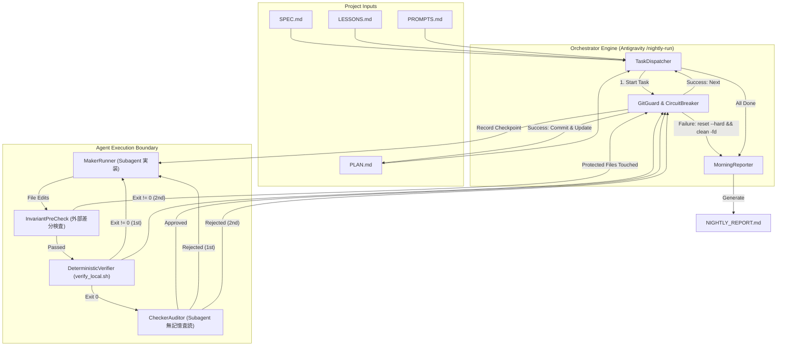

# Auto Developer: Antigravity Autonomous Pipeline Orchestrator

[](.github/workflows/verify.yml)
[](LICENSE)

**Auto Developer** は、Google Antigravity および Elephant-Goldfish Model（EGM）の設計規律に基づき、**「夜寝ている間にAIエージェントが安全に実装・検証・コミットを自動完遂する」** ことを実現する自律型直列パイプライン・オーケストレーターです。

---

## 🎯 解決する課題

自律型AIエージェントに複数タスクを一括して任せたり並列実行させたりすると、以下の問題によってほぼ確実に破綻します：
1. **マージコンフリクトと意味論的破壊**: 複数Workerが並行してコードを書くと、Gitの衝突や型の不整合が多発し、人間のいない夜間にCIを通過できない。
2. **コンテキスト汚染と幻覚の蓄積**: 1つの長い会話セッションで全タスクを回すと、エラー履歴によってトークンが逼迫し、後半タスクで仕様忘れやハルシネーションが急増する。
3. **カスケード障害の連鎖**: あるタスクで失敗した不完全なコードが残ったまま後続タスクが走り、以後のテストが全滅する。
4. **テストコードの勝手な改ざん**: テストが通らないとき、エージェントがテスト側を弱めたりコメントアウトして強引に通してしまう。

Auto Developer は、**「Strict Fail-Fast」「タスクごとの無記憶独立実行」「外部差分による不変条件保護」「未追跡ファイル含めたクリーンロールバック」** を機械的に強制することで、無人稼働でも朝起きたときに確実に動くコードを残します。

---

## 🏗️ アーキテクチャ

Auto Developer は、Antigravity ワークスペーススキル（`/nightly-run`）と決定論的 Python CLI ヘルパー（`scripts/nightly_orchestrator.py`）によって構成されます。



---

## 🛡️ 厳格な4大安全ガードレール (Safety Invariants)

1. **クリーンツリー事前検証 (Pre-flight Assertion)**
   - 起動時に `git status --porcelain` を検査。日中の未コミット作業が残っている場合は Exit 2 で起動を拒否し、ユーザーの作業消失を防ぎます。
2. **外部不変条件保護 (External Invariant Check)**
   - 各タスクの実装後、テストスクリプト実行前に `git diff --name-only <checkpoint>` を検査。
   - 保護ファイル（`.github/**`, `SPEC.md`, `scripts/verify_local.sh`, 免疫テスト）への改変を検知した瞬間、テスト実行を待たずに即時強制ロールバックを発動します。
3. **無記憶 Checker による独立査読 (Stateless Binary Review)**
   - 実装時の会話ログを一切持たない独立エージェントに `SPEC.md` と `git diff` のみを提示。仕様外のコード混入やテスト改ざんを客観的・二値的（`APPROVE` / `REJECT`）にブロックします。
4. **Strict Fail-Fast & クリーンロールバック (Clean Rollback)**
   - 同一タスクで2回失敗した場合、推測で後続に進まず直ちにパイプラインを安全停止。
   - `git reset --hard <checkpoint> && git clean -fd` により、未追跡のゴミファイルや中間生成物も含めて作業ツリーを完全に初期化し、`NIGHTLY_REPORT.md` とエラーログを生成して人間にハンドオフします。

---

## 🚀 クイックスタート

### 前提条件
- Python 3.10 以上
- Git
- Google Antigravity（または Claude Code / Codex 等の EGM 対応環境）

### インストール & セットアップ
```bash
# 依存ツールのインストール（オプション）
pip install -e ".[dev]"

# 検証ゲートの確認
bash scripts/verify_local.sh
```

### 開発ワークフロー（夜間自律実行）

1. **仕様とタスクを固める**
   - EGM プラグイン（`/egm-brainstorm` → `/egm-draft` → `/egm-review`）を使って `SPEC.md` を作成。
   - `PLAN.md` に実行タスクを順に記述：
     ```markdown
     ## ステップ
     - [ ] 1. ユーザー認証の型定義を追加する
     - [ ] 2. JWT トークン検証ロジックを実装する
     - [ ] 3. 認証ミドルウェアのエンドツーエンドテストを作成する
     ```

2. **就寝前に自律実行を起動する**
   Antigravity のチャットで以下を実行します：
   ```text
   /nightly-run
   ```

3. **朝起きたらレポートを確認する**
   - 正常完了または停止時、プロジェクトルートに `NIGHTLY_REPORT.md` が出力されます。
   - コミット履歴（`git log --oneline`）とレポートを確認し、マージまたは残課題の対応を行います。

---

## 🛠️ CLI リファレンス (`scripts/nightly_orchestrator.py`)

オーケストレーターは Antigravity のほか、スタンドアロン CLI やスクリプトからも呼び出せます。

```bash
# ヘルプとバージョン表示
python3 scripts/nightly_orchestrator.py --version
python3 scripts/nightly_orchestrator.py --help

# ドライラン（シミュレーション実行）
python3 scripts/nightly_orchestrator.py --dry-run

# サブコマンド（エージェント連携用）
python3 scripts/nightly_orchestrator.py pre-flight
python3 scripts/nightly_orchestrator.py verify-step --checkpoint <commit_hash>
python3 scripts/nightly_orchestrator.py commit-step --task-id <task_id>
python3 scripts/nightly_orchestrator.py rollback-step --checkpoint <commit_hash> --task-id <task_id>
```

---

## 📁 ディレクトリ構成

```text
auto_developer/
├── AGENTS.md                  # エージェント憲章（行動規範）
├── SPEC.md                    # プロダクト仕様書と不変条件
├── PLAN.md                    # タスク計画・ステート管理ファイル
├── LESSONS.md                 # 過去の地雷・設計ミスの外部記憶
├── PROMPTS.md                 # Maker / Checker 無記憶プロンプト集
├── docs/designs/              # EGM 承認済みの詳細設計書
├── scripts/
│   ├── nightly_orchestrator.py # 直列パイプライン・オーケストレーター
│   └── verify_local.sh        # 不変条件検査 & 決定論的検証ゲート
├── skills/
│   └── nightly-run/SKILL.md   # Antigravity ワークスペーススキル定義
├── tests/
│   └── test_nightly_orchestrator.py # 受入テストスイート
└── pyproject.toml             # Python パッケージ & ツール設定
```

---

## 🧪 テストの実行

```bash
# ローカル検証スクリプトの実行（全不変条件検査 & テストスイート）
bash scripts/verify_local.sh

# Python 単体・受入テストの実行
python3 -m unittest discover -s tests -p "test_*.py"
```

---

## 📜 ライセンス

本プロジェクトは [Apache License 2.0](LICENSE) の下で公開されています。
