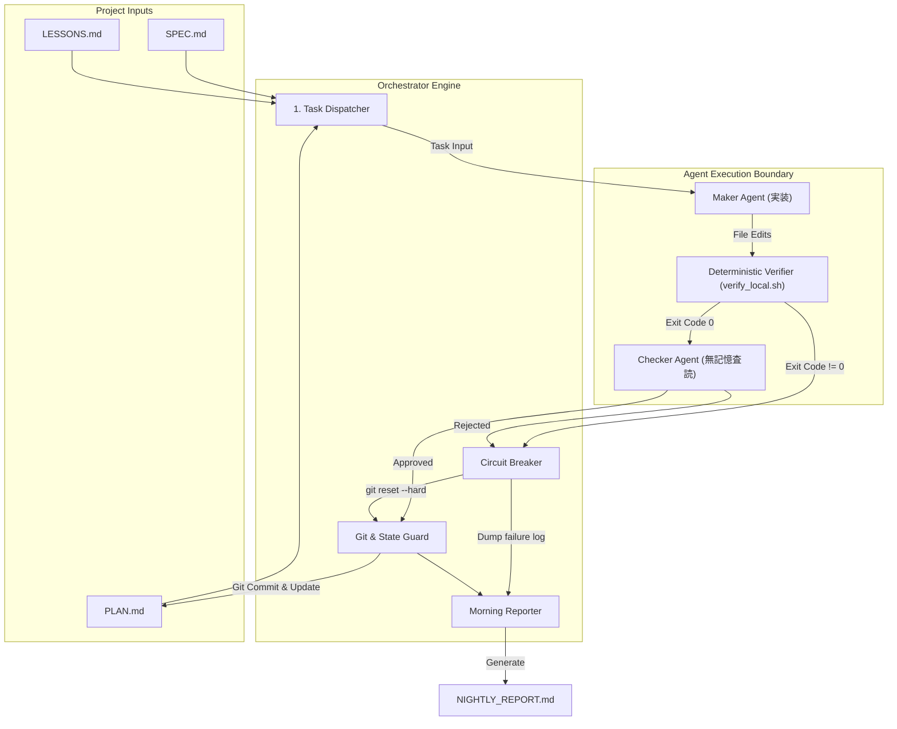
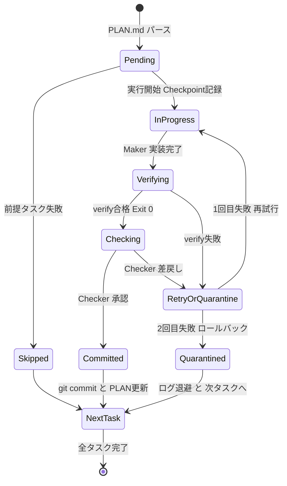

# Antigravity Autonomous Pipeline Orchestrator (夜間自律稼働エンジン)

* **Author:** @hamatsumakoto
* **Status:** Draft
* **Date:** 2026-11-03

--------------------------------------------------------------------------------

## Overview

人間が不在の夜間時間帯等において、EGM設計書（`SPEC.md` / `docs/designs/`）および作業計画書（`PLAN.md`）に基づき、タスクを1ステップずつ安全かつ確実に自動完遂するAntigravity向け自律直列パイプライン・オーケストレーター。

## The Problem

自律型AIエージェントに複数タスクを一括して任せると、コンテキストの肥大化による指示の歪み（伝言ゲーム）、エラー発生時の自己修復ループの暴走（テストコードの改ざんやトークンの過大消費）、および未検証コードの残存による後続タスクの連鎖崩壊（カスケード障害）が発生する。特に並列実行やロングセッションではマージコンフリクトや意味論的破綻が起きやすく、無人での夜間実行を阻む最大の障壁となっている。

本機能は、`AGENTS.md` の開発憲章（「最小限の変更」「1ステップごとの［実装 → 独立検証 → コミット］」「無記憶Checkerによる査読」「同一失敗2回での停止」）を機械的ステートマシンとして強制し、タスクごとに独立したセッションを起動・検証・コミットする。タスク失敗時は作業ツリーを直前のクリーンコミットまで強制ロールバックして隔離ログへ退避し、後続の独立タスクを安全に継続することで、翌朝に検証済みコードと明確な残課題レポートを提供する。

## Goals

* **決定論的な直列パイプライン実行**: `PLAN.md` に記載されたタスクを依存順に抽出し、タスクごとに [実装（Maker） → 独立検証（ローカルCI） → 査読（無記憶Checker） → コミット] を1サイクルとして着実に完遂する。
* **カスケード障害の遮断（Fault Isolation）**: 同一タスクで検証エラーまたは査読差戻しが2回連続した場合、直ちに作業ツリーを `git reset --hard` でロールバックし、エラーダンプを `logs/nightly/` に隔離保存して後続の独立タスクへ進む。
* **無記憶Checker（Stateless Reviewer）による受入判定**: 実装時の会話ログを一切持たない独立したサブエージェントに `SPEC.md` と `git diff` のみを提示し、余計なコード追加や仕様逸脱を機械的・客観的にブロックする。
* **翌朝の朝次レポート生成（Morning Report）**: 実行完了時、完了したコミット一覧、スキップ/隔離されたタスクの理由、および人間が起床後に判断すべきブロック事項をまとめた `NIGHTLY_REPORT.md` を出力する。

## Non-Goals

* **複数Workerの同時並行Git編集**: マージコンフリクトおよび意味論的衝突のリスクを回避するため、初期フェーズでは同一リポジトリに対する複数Workerの並行編集はサポートしない（直列実行に限定）。
* **仕様（SPEC.md）の自己改変・自動更新**: 人間が承認した仕様（SPEC.md）をエージェントが自律的に修正・緩和することは禁止する。
* **クラウド分散環境・外部DBへの依存**: 外部サーバーや分散DBを要求せず、Antigravity環境とローカルGit/CLIのみで完結する。

## Open Questions

* **Question 1 (DAG依存関係の表現形式)**: `PLAN.md` において、タスク間の依存関係を明示的なメタデータ（例: `<!-- depends_on: [task-1] -->`）として記述するか、それとも「同一見出しセクション内の直列依存」という規則ベースで判定するか。
* **Question 2 (Checkerの自動剪定権限)**: Checkerエージェントによる「不要コードの直接削除・軽微な整理」を自動コミットに含めるか、それともCheckerは承認/差戻しの二値判定に徹するか。

## Critical User Journeys (CUJs)

### CUJ 1: 夜間の全タスク正常完遂
* **Given**: 人間が承認した `SPEC.md` と、複数タスクが定義された `PLAN.md` が存在し、Gitツリーがクリーンな状態。
* **When**: 開発者が夜間就寝前にオーケストレーターコマンド（例: `/nightly-run` またはスクリプト）を起動する。
* **Then**: オーケストレーターがPLAN.mdの各タスクを順に実行。各タスクでMakerが実装し、ローカル検証スクリプト（テスト・型検査）とCheckerの査読を通過してコミットが作成される。朝起きた時点で全タスクが完了し、`NIGHTLY_REPORT.md` に成功サマリーが記録されている。

### CUJ 2: 途中タスク失敗時の隔離と後続継続
* **Given**: Task 1（基盤実装）と Task 2（独立した別機能）が存在する状態。
* **When**: Task 1 の実装でテストが2回連続で失敗する。
* **Then**: オーケストレーターはCircuit Breakerを発動し、Git作業ツリーをTask 1開始直前の状態にロールバック。エラーログを `logs/nightly/task_1_failure.log` に隔離し、PLAN.mdのTask 1を `[!]`（失敗）とマーク。Task 1に依存しないTask 2へ進み、Task 2は正常に実装・検証・コミットを完了させる。翌朝のレポートにTask 1の失敗理由が明示される。

--------------------------------------------------------------------------------

## Technical Plan (Architecture)

### 1. システム全体構成とコンポーネント分割

オーケストレーターは、外部依存を持たないスタンドアロンのPythonスクリプト（`scripts/nightly_orchestrator.py`）およびAntigravity連携スキル（`/nightly-run`）として構成される。主要コンポーネントは以下の5つの疎結合モジュールに分割される。

### 2. モジュール責務

1. **Task Dispatcher (`PlanManager`)**
   - `PLAN.md` をパースし、未完了タスク（`- [ ]`）を1件抽出。
   - タスク依存関係（セクション内直列順、または明示的依存タグ）を評価し、前提タスクが失敗している場合はスキップマーク（`- [-]`）を付与して後続へ。
   - `LESSONS.md` から関連する Trap 項目を検索し、Makerへのプロンプトに注入する。
2. **Stateless Maker Dispatcher (`AgentRunner`)**
   - Antigravity の `invoke_subagent`（またはCLIサブプロセス）を呼び出し、タスク専用の新しいコンテキストを生成。
   - プロンプトには「該当タスク」「SPEC.mdの該当節」「LESSONS.mdの注意事項」のみを渡し、過去タスクの思考ログは遮断する。
3. **Deterministic Verifier (`VerifyGate`)**
   - `.github/workflows/verify.yml` と同等のローカル検証スクリプト（`scripts/verify_local.sh`）を実行。
   - 静的型検査（`tsc` / `mypy` 等）、リンター、受入・単体テスト、機密スキャンを実行し、Exit Code 0 のみを合格と判定。
4. **Stateless Checker (`CheckerAuditor`)**
   - 実装会話ログを一切持たない独立サブエージェントを起動。
   - 入力: `SPEC.md`、タスク開始コミットからの `git diff`、および `VerifyGate` の実行ログ。
   - 出力: `APPROVE`（承認）または `REJECT`（差戻し理由付き）。不要コードの混入、仕様逸脱、テストの勝手な改ざんを検査する。
5. **Git & Circuit Breaker (`GitGuard`)**
   - 各タスク開始直前の `HEAD` コミットハッシュを記録。
   - **リトライ制御**: 同一タスクでの失敗（VerifyエラーまたはChecker差戻し）をカウント。
     - 1回目失敗: エラーログをフィードバックしてMakerに1回のみ再試行を許可。
     - 2回目失敗: 即座に `git reset --hard <checkpoint>` を実行し、作業ツリーを完全初期化。失敗ログを `logs/nightly/task_<id>_failure.log` に退避し、`PLAN.md` のタスクを `[!]`（失敗）に更新。
   - **成功時処理**: `git commit -m "feat/fix: <task title> [refs: <task_id>]"` を実行し、`PLAN.md` を `[x]` に更新。
6. **Morning Reporter (`Reporter`)**
   - 全タスク処理後、朝次ハンドオフ用レポート `NIGHTLY_REPORT.md` をルート直下に自動生成。

### 3. データモデルとタスク状態遷移

### 4. 厳格な保護ガードレール（Safety Invariants）

- **保護ファイルの改変検知**: Maker が `.github/`、`verify_local.sh`、`SPEC.md`、免疫テストファイルを改変した場合、VerifyGateが即座にエラーとし、リトライさせず直ちにQuarantine（隔離ロールバック）を発動する。
- **リソース上限**: 1タスクあたりの最大実行時間（デフォルト300秒）、最大サブエージェントターン数（最大10ターン）を設定し、ハングや無限ループを物理遮断する。

--------------------------------------------------------------------------------

## Alternatives Considered

### Alternative 1: Chief of Staff → PM → 多数Workerの非同期・並列実行

*   **Pros**: 独立した複数タスクを同時に消化できるため、壁時計時間を短縮できる可能性がある。
*   **Cons**:
    *   **意味論的衝突**: 各Workerがgit worktreeで同時変更したコードをマージする際、型不整合や構文コンフリクトが多発し、人間のいない夜間にCIを通過させるのが極めて困難。
    *   **伝言ゲーム**: 階層が増えるほど要件が劣化し、プロンプトトークンとコストが爆発する。
*   **Reason for Rejection**: 夜間稼働の主目的は「速度」ではなく「朝起きたときの信頼性・完遂性」であるため。競合解決コストが並列化のメリットを大幅に上回る。

### Alternative 2: 単一ロングセッションでの一括自律実行

*   **Pros**: 単一エージェントに「PLAN.mdを最後までやって」と指示するだけで済み、オーケストレーターの実装が不要。
*   **Cons**:
    *   **コンテキスト汚染**: タスクを進めるにつれて過去のエラーログや試行錯誤がコンテキストウィンドウを圧迫し、後半タスクで幻覚や仕様忘れが急増する。
    *   **カスケード崩壊**: 1つのタスクで失敗した不完全なコードが残ったまま次のタスクに着手し、全タスクが連鎖的に破壊される。
*   **Reason for Rejection**: エラーからの自己回復ができず、翌朝に壊れたコードベースが残るリスクが極めて高いため。

### Alternative 3: 外部エージェントフレームワーク（LangGraph / CrewAI / Docker分散環境）の導入

*   **Pros**: グラフ構造や状態永続化、分散Worker管理の既存エコシステムを活用できる。
*   **Cons**:
    *   **環境依存と重厚性**: Python仮想環境、Dockerコンテナ、クラウドAPIキー、外部DBのセットアップが必須となり、開発者の導入摩擦が大きい。
    *   **auto_developer 思想との乖離**: 本リポジトリの「ローカル完結・軽量・外部DB不要」という設計思想（SPEC.md）に反する。
*   **Reason for Rejection**: Antigravity ネイティブのサブエージェントおよびローカルGit/シェルスクリプトで同等の直列ステートマシンが十分軽量に実現可能なため。

--------------------------------------------------------------------------------

## Detailed Implementation Plan

### Target Files to Create/Modify

#### 1. `scripts/nightly_orchestrator.py` (Create)
* **Type / Scope**: Python CLI / オーケストレーション・ステートマシン
* **Proposed Changes**:
  * `PlanParser`: `PLAN.md` のタスクリストを解析し、未実行タスク（`- [ ]`）の抽出、セクション単位の依存関係解決、ステータス（`[x]`, `[!]`, `[-]`）更新ロジックを実装。
  * `GitManager`: 作業開始前のチェックポイント（`git rev-parse HEAD`）記録、検証合格時のアトミックコミット作成（`git commit -m ...`）、およびQuarantine時の強制ロールバック（`git reset --hard <checkpoint>`）を実装。
  * `VerifyRunner`: `scripts/verify_local.sh` をサブプロセスとして実行し、標準出力・標準エラーをキャプチャしてExit Codeによる合否判定を行う。
  * `CircuitBreaker`: 同一タスクの連続失敗回数（上限2回）を管理し、2回失敗時に隔離ログ保存とロールバックを発動。
  * `MorningReporter`: 実行完了時に `NIGHTLY_REPORT.md` をルート直下に自動生成。

#### 2. `scripts/verify_local.sh` (Create)
* **Type / Scope**: ローカル検証シェルスクリプト（CI互換ゲート）
* **Proposed Changes**:
  * `.github/workflows/verify.yml` の検証項目（静的型検査、リンター、単体テスト、セキュリティスキャン）をローカルで順次実行。
  * 保護対象ファイル（`.github/`、`verify_local.sh`、`SPEC.md`）がコミット前差分で改変されていないかを検査するガードレールを実装。
  * すべて合格時のみ Exit 0、いずれか失敗時は Exit 1 を返す。

#### 3. `skills/nightly-run/SKILL.md` (Create)
* **Type / Scope**: Antigravity スキル定義
* **Proposed Changes**:
  * ユーザーが `/nightly-run` でオーケストレーターを起動できるようにするスキル定義。
  * バックグラウンド実行の指示、ログ追跡、完了時のハンドオフプロンプトを定義。

#### 4. `PLAN.md` (Modify)
* **Type / Scope**: タスク計画・ステート管理ドキュメント
* **Proposed Changes**:
  * オーケストレーターが認識する状態記法（`[x]` 完了、`[!]` 失敗/隔離、`[-]` 依存不成立スキップ）の説明を追加。
  * 失敗時の記録先（`## 止まっていること・判断待ち`）のフォーマットを規約化。

#### 5. `PROMPTS.md` (Modify)
* **Type / Scope**: エージェント向けプロンプト集
* **Proposed Changes**:
  * オーケストレーターが Maker および Checker のサブエージェントに渡すための無記憶テンプレートを追加。

#### 6. `tests/test_nightly_orchestrator.py` (Create)
* **Type / Scope**: 単体・統合テストスイート（pytest）
* **Proposed Changes**:
  * `PLAN.md` のパース、状態遷移、スキップ判定の単体テスト。
  * 一時Gitリポジトリを用いたチェックポイント記録、成功コミット、ロールバック（Circuit Breaker）の結合テスト。
  * `NIGHTLY_REPORT.md` の生成フォーマット検証テスト。

#### 7. `SPEC.md` (Modify)
* **Type / Scope**: 製品仕様書
* **Proposed Changes**:
  * 本オーケストレーターの要件、非機能制約、完了定義を `SPEC.md` のコア仕様として追記。

### Verification Plan

* **Compilation/Static Analysis**:
  * `ruff check scripts/ tests/` (または `flake8`)
  * `mypy scripts/ tests/`
* **Unit Tests**:
  * `pytest tests/test_nightly_orchestrator.py -v`
* **E2E / Dry-Run Verification**:
  * サンプル `PLAN.md` を用いたドライランモード（`python3 scripts/nightly_orchestrator.py --dry-run`）による状態遷移検証。
  * 意図的に失敗するテストケースを含むモック環境での Circuit Breaker ロールバックと `NIGHTLY_REPORT.md` 生成の動作確認。
* **Verification Gate**:
  * `bash scripts/verify_local.sh` がエラーなく Exit 0 で完了すること。

--------------------------------------------------------------------------------

*Drafted with EGM*
