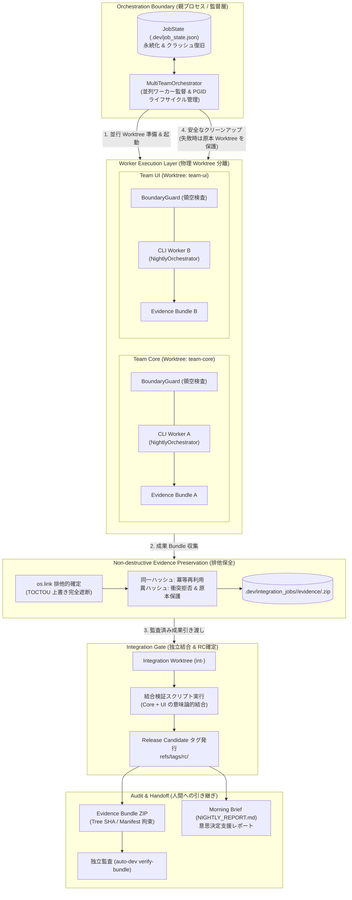
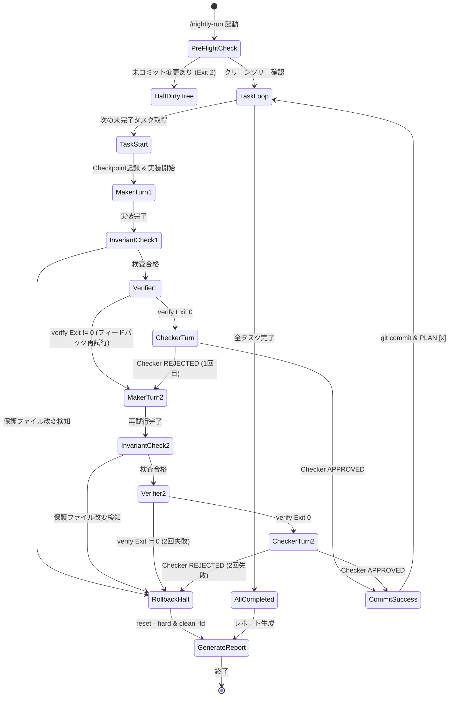

# Antigravity Autonomous Pipeline Orchestrator (夜間自律稼働エンジン)

* **Author:** @hamatsumakoto
* **Status:** In Review (Approved by Goldfish Swarm)
* **Date:** 2026-11-03

--------------------------------------------------------------------------------

## Overview

人間が不在の夜間時間帯等において、EGM（Elephant-Goldfish Model）設計書（`SPEC.md` / `docs/designs/`）および作業計画書（`PLAN.md`）に基づき、タスクを1ステップずつ安全かつ確実に自動完遂するAntigravity向け自律直列パイプライン・オーケストレーター。

### 用語定義 (Glossary)
* **EGM (Elephant-Goldfish Model)**: 上流の企画・設計（Elephant）と、記憶を持たない独立した査読・検証エージェント（Goldfish）を組み合わせて仕様・実装の品質を担保する開発手法。
* **免疫テスト (Immunity Tests)**: 過去の重大バグや設計違反の再発を防ぐ回帰テストスイート（`tests/immunity/**` 等）。仕様変更時を除き、実装エージェントによる改変・削除が厳格に禁止されている保護アセット。
* **Strict Fail-Fast**: タスク失敗が2回連続した場合に憶測で後続処理を続けず、直ちに作業ツリーを完全初期化してパイプライン全体を停止し、人間の朝次判断に委ねる安全設計。

--------------------------------------------------------------------------------

## The Problem

自律型AIエージェントに複数タスクを一括して任せると、コンテキストの肥大化による指示の歪み（伝言ゲーム）、エラー発生時の自己修復ループの暴走（テストコードの改ざんやトークンの過大消費）、および未検証コードの残存による後続タスクの連鎖崩壊（カスケード障害）が発生する。特に並列実行やロングセッションではマージコンフリクトや意味論的破綻が起きやすく、無人での夜間実行を阻む最大の障壁となっている。

本機能は、`AGENTS.md` の開発憲章（「最小限の変更」「1ステップごとの［実装 → 独立検証 → コミット］」「無記憶Checkerによる査読」「同一失敗2回での停止」）を機械的ステートマシンとして強制し、タスクごとに独立したセッションを起動・検証・コミットする。タスク失敗時は作業ツリーを直前のクリーンコミットまで強制ロールバック（`git reset --hard && git clean -fd`）して隔離ログへ退避し、パイプラインを安全停止（Fail-Fast）することで、翌朝に検証済みコードと明確な残課題レポートを提供する。

--------------------------------------------------------------------------------

## Goals

* **決定論的な直列パイプライン実行**: `PLAN.md` に記載されたタスクを上から順に1つずつ抽出し、タスクごとに [実装（Maker） → 独立検証（ローカルCI） → 査読（無記憶Checker） → コミット] を1サイクルとして着実に完遂する。
* **厳格なカスケード障害の遮断（Strict Fail-Fast & Clean Rollback）**: 同一タスクで検証エラーまたは査読差戻しが2回連続した場合、直ちに作業ツリーを `git reset --hard <checkpoint> && git clean -fd` で初期化し、エラーダンプを `logs/nightly/` に隔離保存してパイプラインを安全停止する。
* **外部ガードレールによる不変条件保護**: Makerが `.github/**`、`SPEC.md`、`scripts/verify_local.sh`、免疫テストを改変した場合、検証コード実行前のGit diff検査で検知し、即座にQuarantine（強制ロールバック）を発動する。
* **無記憶Checker（Stateless Reviewer）による二値判定**: 実装時の会話ログを一切持たない独立したサブエージェントに `SPEC.md` と `git diff` のみを提示し、余計なコード追加や仕様逸脱を客観的・二値的（`APPROVE` / `REJECT`）にブロックする。
* **翌朝の朝次レポート生成（Morning Report）**: 実行完了または停止時、完了したコミット一覧、失敗/隔離されたタスクの理由、および人間が起床後に判断すべきブロック事項をまとめた `NIGHTLY_REPORT.md` を出力する。

--------------------------------------------------------------------------------

## Non-Goals

* **複数Workerの同時並行Git編集**: マージコンフリクトおよび意味論的衝突のリスクを回避するため、初期フェーズでは同一リポジトリに対する複数Workerの並行編集はサポートしない（直列実行に限定）。
* **仕様（SPEC.md）の自己改変・自動更新**: 人間が承認した仕様（SPEC.md）をエージェントが自律的に修正・緩和することは禁止する。
* **タスクの憶測的スキップと継続**: 失敗タスクが発生した際に、未検証の前提の上に後続タスクを推測で継続することはしない（厳格なFail-Fastを採用）。
* **クラウド分散環境・外部DBへの依存**: 外部サーバーや分散DBを要求せず、Antigravity環境とローカルGit/CLIのみで完結する。

--------------------------------------------------------------------------------

## Architectural Decisions (Resolved Questions)

* **Decision 1 (タスク順序と依存関係モデル: Strict Sequential & Fail-Fast)**:
  * `PLAN.md` のタスクリストは上から順に直列実行する。カスタムコメントタグ（`<!-- depends_on -->`）等の複雑なDAGパーサーは実装せず（YAGNI原則）、いずれかのタスクが2回失敗した時点でパイプライン全体を即座に安全停止する。
* **Decision 2 (Checkerの権限: Strict Binary Gatekeeper)**:
  * 無人夜間バッチにおいて、Checkerにコード修正・不要コード剪定のコミット権限を与えず、`APPROVE` または `REJECT` の二値判定に徹する。修正が必要な場合はMakerへ差し戻すか、2回目なら停止する。
* **Decision 3 (ランタイム境界: Job Orchestrator & Runner Adapter)**:
  * 単一の会話セッションへの依存を排除し、Python の独立プロセス（`NightlyOrchestrator`）を親として設計。`.dev/job_state.json` に実行状態（JobState）を永続化し、プロセス中断やクラッシュ時にも `--resume` で安全に直前のチェックポイントから再開可能とする。AIセッション（Maker/Checker）の起動と監視は `RunnerAdapter` により抽象化する。
* **Decision 4 (作業成果の隔離退避: Quarantine Preservation)**:
  * 従来の `git reset --hard` & `git clean -fd` による破壊的ロールバックを廃止。タスク失敗時は作業ツリーの差分を `quarantine/task-<id>-*` ブランチへ退避コミットした上で本線を直前のチェックポイントへ復元する。本線の安全性と試行錯誤成果の保存を完全に両立する。
* **Decision 5 (確定ゲートの厳格化: Evidence-Gated Commit)**:
  * 未検証コードの混入を防ぐため、決定論的検証（`verify-step`）通過時にハッシュ拘束された Evidence Token を発行。コミット処理（`commit-step`）はこの証跡を検証・ワンタイム消費しない限り Exit 3 で物理遮断する。
* **Decision 6 (翌朝の意思決定支援: Actionable Morning Brief)**:
  * 単なる件数ダンプを廃止し、人間が朝戻ってきた際に3分で状況を把握し、具体的なコマンド（差分確認、ログ調査、再試行、破棄）とともに次の判断を下せる `AUTO DEVELOPER / MORNING BRIEF` および CLI コマンド `morning-brief` を提供する。

--------------------------------------------------------------------------------

## Critical User Journeys (CUJs)

### CUJ 1: 夜間の全タスク正常完遂
* **Given**: 人間が承認した `SPEC.md` と複数タスクが定義された `PLAN.md` が存在し、Gitツリーがクリーン（`git status --porcelain` が空）な状態。
* **When**: 開発者が就寝前に `/nightly-run` を起動する。
* **Then**: オーケストレーターが `PLAN.md` のタスクを順に実行。各タスクでMakerが実装し、不変条件検査、ローカル検証スクリプト、Checkerの査読を通過してコミットが順次作成される。全タスク完了後、`NIGHTLY_REPORT.md` に成功サマリーが生成され、朝起きた時点で即座に確認・マージ可能な状態となる。

### CUJ 2: 途中タスク失敗時の安全停止（隔離退避と意思決定支援）
* **Given**: Task 1, Task 2 が順に定義された状態。
* **When**: Task 1 の実装でテストが2回連続で失敗する（または保護ファイルを不正改変する）。
* **Then**: オーケストレーターはCircuit Breakerを発動し、作業ツリーの変更を `quarantine/task-1-*` ブランチへ退避コミット。その後、本線作業ツリーを直前のクリーンチェックポイントへ復元（`git reset --hard && git clean -fd`）。エラーログを `logs/nightly/task_1_failure.log` に保存し、`PLAN.md` のTask 1を `- [ ] Task 1 **[FAILED]**` とマーク。パイプラインを即座に安全停止し、翌朝の意思決定支援レポート（`AUTO DEVELOPER / MORNING BRIEF`）に隔離ブランチ差分確認コマンドや `--resume` 再試行コマンドを提示して人間に引き継ぐ。

--------------------------------------------------------------------------------

## Technical Plan (Architecture)

### 1. システム全体構成



### 2. モジュール責務（Canonical Nomenclature）

1. **`MultiTeamOrchestrator`**:
   - 複数チームの設定（`MultiTeamConfig`）に基づき、各チームの独立作業環境を準備・監督。
   - ワーカープロセス起動時に独立したプロセスグループ（PGID）を割り当て、親プロセス停止時やタイムアウト時の孤児プロセス残存を物理遮断。
   - 各チームの成果物退避（`preserve_team_bundles`）および統合ゲートへの引き渡しを統括。
2. **`WorktreeManager`**:
   - 各チーム専用の Git Worktree（`.dev/worktrees/<team_id>/`）およびブランチを安全に作成・管理・解放。
   - ディレクトリの実態照合による安全な削除と、未マージ成果の無断削除防止を保証。
3. **`BoundaryGuard`**:
   - `TeamManifest` の `owns` 設定に基づき、チームが担当外の領域（領空）を変更・作成・削除することを Git レベルで検知・遮断。
4. **`EvidencePreservation` (`preserve_team_bundles`)**:
   - `os.link` を用いた排他的確定により、存在確認から確定までの TOCTOU 競合による上書きを完全防止。
   - 同一成果物は冪等に再利用し、異成果衝突時は `BUNDLE_PRESERVATION_COLLISION` として拒否し、Worktree 原本を安全に保護。
5. **`IntegrationGate`**:
   - 複数チームの成果ブランチを独立した統合専用 Worktree にマージし、2-Phase Verification で結合検査。
   - 全チームの成果が検証された場合のみ原子的 RC タグ（`refs/tags/rc/<job_id>`）を発行。
6. **`EvidenceBundler` & Verifier**:
   - コミット履歴、Evidence Record、Checker ログを集約した改ざん防止 ZIP パッケージ（`bundle_<job_id>.zip`）を生成。
   - `auto-dev verify-bundle` による暗号学的完全性検証（Tree SHA、ハッシュ照合）を提供。
7. **`TaskDispatcher` & `GitGuard`**:
   - 各ワーカー内部での直列タスク抽出、クリーンツリー検査、保護ファイル不変条件検査、および証跡拘束確定コミット（`verify-step` / `commit-step`）。
8. **`MorningReporter`**:
   - 正常終了時またはFail-Fast停止時に `NIGHTLY_REPORT.md` をルート直下に自動生成。

### 3. データモデルとステータス遷移



### 4. 成果物スキーマ仕様

#### A. `NIGHTLY_REPORT.md` テンプレート
```markdown
# Nightly Execution Report: YYYY-MM-DD HH:MM:SS

## 1. Summary
* **Status**: [COMPLETED | STOPPED (FAIL-FAST)]
* **Total Tasks**: N
* **Succeeded**: M
* **Quarantined**: K (0 or 1)
* **Remaining**: R
* **Checkpoint Restored**: [commit_hash | N/A]

## 2. Completed Tasks
| Task ID | Description | Commit Hash | Verified By |
| --- | --- | --- | --- |
| task-1 | Description 1 | `abc1234` | verify_local.sh & Checker |

## 3. Quarantined Task (If Failed)
* **Failed Task ID**: task-X
* **Failure Phase**: [INVARIANT_BREACH | VERIFIER_ERROR | CHECKER_REJECT]
* **Failure Log**: `logs/nightly/task_X_failure.log`
* **Root Cause Summary**:
  ```text
  [First 10 lines of error trace]
  ```

## 4. Next Actions for Developer
- [ ] Review quarantined task failure log
- [ ] Inspect git diff of succeeded commits: `git log --oneline -M`
```

#### B. `logs/nightly/task_<id>_failure.log` スキーマ
```text
=== TASK FAILURE DUMP ===
Task ID: <task_id>
Task Title: <task_title>
Checkpoint Commit: <hash>
Timestamp: <ISO-8601>

--- ATTEMPT 1 LOG ---
<stderr output from verify or checker rationale>

--- ATTEMPT 2 LOG ---
<stderr output from verify or checker rationale>

--- WORKSPACE GIT DIFF BEFORE ROLLBACK ---
<git diff output prior to reset>
```

#### C. `PLAN.md` 状態表現規約
```markdown
- [ ] 1. タスクタイトル (未着手)
- [x] 1. タスクタイトル (完了・コミット済)
- [ ] 1. タスクタイトル **[FAILED]** (2回失敗により停止・ロールバック済)
```

--------------------------------------------------------------------------------

## Alternatives Considered

### Alternative 1: Chief of Staff → PM → 多数Workerの非同期・並列実行
* **Pros**: 複数タスクを同時に消化できるため、壁時計時間を短縮できる可能性がある。
* **Cons**:
  * 各Workerが並行変更したコードのマージ時に型不整合や意味論的衝突が多発し、人間のいない夜間にCIを通過させるのが極めて困難。
  * 階層構造による伝言ゲームとトークン消費の爆発。
* **Reason for Rejection**: 夜間稼働の主目的は「速度」ではなく「朝起きたときの信頼性・完遂性」であるため。

### Alternative 2: 単一ロングセッションでの一括自律実行
* **Pros**: 単一エージェントに「PLAN.mdを最後までやって」と指示するだけで済み、実装が不要。
* **Cons**: タスク進行に伴い過去のエラーログがコンテキストを圧迫し、後半タスクで幻覚や仕様忘れが急増。失敗した不完全なコードが残ったまま後続に着手して全タスクが連鎖破壊される。
* **Reason for Rejection**: エラーからの自己回復ができず、翌朝に壊れたコードベースが残るリスクが極めて高いため。

### Alternative 3: 失敗タスクをスキップして後続を推測継続するモデル
* **Pros**: 途中のタスクが失敗しても、残りの独立タスクを消化できる可能性がある。
* **Cons**:
  * ソフトウェアのタスクは暗黙の依存関係を持ち、推測での継続は高確率でカスケード崩壊を引き起こす。
  * `AGENTS.md` Rule 5（2回失敗で停止）に明確に違反する。
  * 複雑なDAGメタデータパーサーが必要になり、コードが脆弱化する。
* **Reason for Rejection**: 確実性と安全性を最優先し、厳格なFail-Fastを採用。

--------------------------------------------------------------------------------

## Detailed Implementation Plan

### Target Files to Create/Modify

#### 1. `pyproject.toml` (Create)
* **Type / Scope**: Python パッケージ・ツール設定
* **Proposed Changes**:
  * プロジェクトメタデータ、Pythonバージョン制約 (`>=3.10`) を定義。
  * 開発・検証用依存関係（`pytest>=8.0.0`, `mypy>=1.9.0`, `ruff>=0.3.0`）を明記。
  * ruff, mypy, pytest の基本設定を記述。

#### 2. `scripts/nightly_orchestrator.py` (Create)
* **Type / Scope**: Python CLI / 決定論的ヘルパーモジュール
* **Proposed Changes**:
  * **CLI Interface**:
    ```bash
    python3 scripts/nightly_orchestrator.py [--plan PLAN.md] [--dry-run] [--timeout 300] [--checkpoint-only]
    ```
    * Exit Code 0: 正常終了
    * Exit Code 1: タスク検証/査読失敗（Circuit Breaker発動・ロールバック完了）
    * Exit Code 2: プリフライト失敗（未コミットの変更が存在、または必須ファイル欠損）
  * **Core Data Classes**:
    ```python
    @dataclass(frozen=True)
    class Task:
        task_id: str
        title: str
        line_number: int
        is_completed: bool
        is_failed: bool

    @dataclass
    class ExecutionResult:
        success: bool
        task_id: str
        error_message: str = ""
        quarantined: bool = False
    ```
  * **Class Signatures**:
    * `TaskDispatcher`:
      * `parse_plan(plan_path: Path) -> list[Task]`
      * `get_next_pending_task(tasks: list[Task]) -> Task | None`
      * `mark_task_status(plan_path: Path, task: Task, status: str) -> None`
    * `GitGuard`:
      * `assert_clean_working_tree() -> None`
      * `get_current_checkpoint() -> str`
      * `check_protected_files_untouched(checkpoint: str) -> bool`
      * `commit_task(task: Task) -> str`
      * `rollback_and_clean(checkpoint: str) -> None`
    * `DeterministicVerifier`:
      * `run_verification(script_path: Path, timeout_sec: int) -> tuple[int, str]`
    * `MorningReporter`:
      * `write_report(report_path: Path, summary_data: dict) -> None`
      * `write_failure_log(log_path: Path, failure_data: dict) -> None`

#### 3. `scripts/verify_local.sh` (Create)
* **Type / Scope**: ローカル検証ゲートスクリプト
* **Proposed Changes**:
  * 実行権限 (`chmod +x`) を付与。
  * 既存リポジトリ検証（Node.js / npm環境がある場合は `npm test` 等）および本オーケストレーター検証（`ruff check scripts/ tests/`, `mypy scripts/ tests/`, `pytest tests/`）を実行。
  * いずれか1つでも失敗した場合は即座に Exit 1、すべて成功時のみ Exit 0 を返す。

#### 4. `skills/nightly-run/SKILL.md` (Create)
* **Type / Scope**: Antigravity ワークスペーススキル定義
* **Proposed Changes**:
  * スキル名 `nightly-run`、説明、起動プロンプトを定義。
  * Antigravityエージェントが本スキル経由で `TaskDispatcher` でタスクを取得し、`invoke_subagent` でMakerおよびCheckerを順次起動してループを完遂するオーケストレーション手順を記載。

#### 5. `PLAN.md` (Modify)
* **Type / Scope**: タスク計画・ステート管理ドキュメント
* **Proposed Changes**:
  * 状態マーカー（`- [ ]`, `- [x]`, `- [ ] Task **[FAILED]**`）の定義を追記。
  * `## 止まっていること・判断待ち` セクションへの夜間自動追記フォーマットを記載。

#### 6. `PROMPTS.md` (Modify)
* **Type / Scope**: エージェント向けプロンプト集
* **Proposed Changes**:
  * オーケストレーターが Maker および Checker に渡す以下の無記憶プロンプトテンプレートをセクションとして追加：
    ```markdown
    ### Maker 無記憶実行プロンプト
    あなたは実装エージェント（Maker）です。
    SPEC.md の要件と PLAN.md の対象タスクのみに従い、必要最小限のコード変更を行ってください。
    保護ファイル（.github/**, SPEC.md, verify_local.sh, tests/immunity/**）は絶対に変更してはなりません。

    ### Checker 無記憶査読プロンプト
    あなたは独立査読エージェント（Checker）です。
    入力は SPEC.md と git diff のみです。
    余計なコードの混入、仕様逸脱、テストの勝手な改ざんを検査し、承認（APPROVE）または具体的理由付き差戻し（REJECT）のいずれかを返してください。
    ```

#### 7. `tests/test_nightly_orchestrator.py` (Create)
* **Type / Scope**: 単体・結合テストスイート（pytest）
* **Proposed Changes**:
  * `TaskDispatcher` のPLAN.mdパースと正規表現更新の単体テスト。
  * モックGit環境を用いた `GitGuard` のクリーンチェック、チェックポイント記録、`git reset --hard && git clean -fd` による未追跡ファイル削除の検証テスト。
  * 保護ファイル改変時の `check_protected_files_untouched` の検知テスト。
  * `MorningReporter` による `NIGHTLY_REPORT.md` 生成フォーマットの検証テスト。

#### 8. `SPEC.md` (Modify)
* **Type / Scope**: プロダクト仕様書
* **Proposed Changes**:
  * コア要件に「自律直列パイプライン・オーケストレーター」の仕様を反映。
  * 不変条件に「保護ファイルの改変防止」「Strict Fail-Fast」「未コミットツリーでの実行禁止」を追記。

--------------------------------------------------------------------------------

### Verification Plan

* **Lint & Formatting**:
  * `ruff check scripts/ tests/`
  * `ruff format --check scripts/ tests/`
* **Type Checking**:
  * `mypy scripts/ tests/`
* **Unit & Integration Tests**:
  * `pytest tests/test_nightly_orchestrator.py -v`
* **Dry-Run & E2E Validation**:
  * `python3 scripts/nightly_orchestrator.py --dry-run` を実行し、サンプルPLAN.mdに対する状態遷移が正しくシミュレートされることを確認。
* **Verification Gate**:
  * `bash scripts/verify_local.sh` がエラーなく Exit 0 で終了すること。

--------------------------------------------------------------------------------

*Drafted with EGM*
